# gha-workflows

`gha-workflows` provides reusable GitHub Actions workflows for application builds, validation, container and Helm publishing, Terraform operations and GitOps manifest updates. Repository maintainers call these workflows as jobs, rather than installing them as Marketplace Actions.

[](https://github.com/f2calv/gha-workflows/actions/workflows/ci.yml)

All reusable workflows are called via `workflow_call`. Shared build and validation workflows generally prefix the `name:` field with `_` (for example, `_app-build-dotnet`) to distinguish them from standalone workflows.

## Usage

Save this complete caller in your repository's `.github/workflows/build.yml`. It calculates a version without publishing, then passes the output into a .NET build:

```yaml
name: build
on: [push, pull_request]
permissions: {}
jobs:
  versioning:
    permissions:
      contents: read
    uses: f2calv/gha-workflows/.github/workflows/gha-release-versioning.yml@v1
    with:
      tag-and-release: false
      tag-prefix: ''
      move-major-tag: false

  build:
    needs: versioning
    permissions:
      contents: read
    uses: f2calv/gha-workflows/.github/workflows/app-build-dotnet.yml@v1
    with:
      version: ${{ needs.versioning.outputs.version }}
      solution-name: Example.slnx
```

Replace `Example.slnx` with your solution and provide `GitVersion.yml` in the caller. Tests require `global.json` selecting Microsoft.Testing.Platform and compatible test projects. Jobs calling reusable workflows do not also declare `steps` or `runs-on`; override the workflow's `runs-on` input instead. See [GitHub's reusable-workflow guidance](https://docs.github.com/en/actions/using-workflows/reusing-workflows).

The existing published `@v1` reference and immutable [v1.8.8 release](https://github.com/f2calv/gha-workflows/releases/tag/v1.8.8) were verified on 20 October 2026. You may replace `@v1` with `@v1.8.8` to lock that historical workflow implementation. This collection has legacy `v`-prefixed/floating tags; it is not a Marketplace Action. New non-Action releases should use plain immutable `X.Y.Z` tags, but no such replacement tag is asserted here.

Contracts below describe the current checkout. Compared with `v1.8.8`, it adds build-context properties and removes Helm environment injection; the release wrapper no longer exposes `tag-only` or `release-branch`. Use the [Action directly](https://github.com/f2calv/gha-release-versioning) when those controls are needed.

## Workflows

### Application Build

| Workflow | Description | Key Inputs |
| --- | --- | --- |
| [App Build .NET](.github/workflows/app-build-dotnet.yml) | Restore, workload restore, build and test a .NET solution/project. Installs .NET 8/9/10 SDKs. Optionally collects coverage, provisions selected Compose services and clones extra repositories into the build context. | `version` (required), `runs-on`, `solution-name`, `configuration`, `execute-tests`, `test-solution-name`, `dotnet-restore-args`, `dotnet-build-args`, `dotnet-test-args`, `collect-coverage`, `coverage-artifact-name`, `test-compose-file`, `test-compose-services`, `extra-repos` |
| [App Build Go](.github/workflows/app-build-go.yml) | Check formatting and modules, run `go vet`, staticcheck, build and test a Go module. The toolchain version comes from `go.mod`. | `version` (required), `runs-on`, `go-version-file`, `package`, `ldflags` |
| [App Build Python](.github/workflows/app-build-python.yml) | Validate the uv lockfile, restore all dependency groups, run Ruff, mypy and pytest, then build the Python package. Its required `version` input is currently unused. | `version` (required), `runs-on` |
| [App Build Rust](.github/workflows/app-build-rust.yml) | Check formatting, run Clippy, fetch dependencies and build a Rust project; does not run Cargo tests or inject its required `version`. | `version` (required), `runs-on` |

`dotnet-test-args` is a JSON array so each argument remains distinct. For example,
`["--filter-class", "Example.Tests.CommandTests"]` uses an xUnit v3 filter rather than VSTest syntax.
The default is `[]`. The caller's test framework must support the supplied arguments.

Tests target `solution-name` by default. Set `test-solution-name` only when a different solution or
project must be tested independently.

`test-compose-services` is a JSON array such as `["database"]` of services to start before testing and stop afterward. Set
`test-compose-file` only when the repository does not use the default Compose filename.

Common build defaults: `runs-on: ubuntu-24.04`, .NET `configuration: Release`,
`execute-tests: true`, `collect-coverage: false`, `coverage-artifact-name: dotnet-coverage`.
Coverage is MTP XML, not the NuGet Action's cobertura/lcov pipeline. Unlike that Action, this
workflow honors `execute-tests: false` even on pull requests; callers own their required gates.
An extra .NET test target is restored and built separately. Coverage requires the caller's
test projects to reference `Microsoft.Testing.Extensions.CodeCoverage`; the workflow uploads
`TestResults/**/*.xml` with one-day retention and fails if no matching files exist.

Go uses `go.mod` by default, `package: ./...`, `ldflags: ''`, injects `main.version`,
and runs race-enabled tests. Python expects a locked uv project containing Ruff, mypy and pytest.
Rust expects Cargo/rustfmt/Clippy on the selected runner; it installs no toolchain.

Where supported, `extra-repos` is a JSON array of objects with `repo`, `ref`, and `path`,
for example `[{"repo":"example/dependency","ref":"main","path":"deps/dependency"}]`.
The implementation uses a shallow `--branch` clone: supply a real branch/tag instead of relying
on its `HEAD` fallback. The caller token must actually have read access; the default token
does not automatically grant access to another private repository.

### Mobile Deployment

| Workflow | Description | Key Inputs |
| --- | --- | --- |
| [Deploy MAUI Android](.github/workflows/_deploy-maui-android.yml) | Build the hard-coded `src/CasCap.App.Maui/CasCap.App.Maui.csproj` target `net10.0-android`, or sign and upload it to Google Play. This is not a generic configurable project path. | `runs-on`, `deploy` (`false`), `dotnet-version` (`10.0.x`), `configuration` (`Release`), `package-name`, `play-track` (`internal`), `app-display-version` (`1.0`), `app-version-code` (`1`) |

### Database

| Workflow | Description | Key Inputs |
| --- | --- | --- |
| [EF Migrations Drift](.github/workflows/ef-migrations-drift.yml) | Fail when the EF Core model has schema changes not captured by a migration (runs `dotnet ef migrations has-pending-model-changes`; no live database required). Installs .NET 8/9/10 SDKs and restores tools. The caller repo must pin `dotnet-ef` in `.config/dotnet-tools.json` and provide an `IDesignTimeDbContextFactory` configured with the migrations provider. | `project` (required), `runs-on`, `startup-project`, `context`, `configuration`, `extra-repos` |

### Infrastructure

| Workflow | Description | Key Inputs |
| --- | --- | --- |
| [Terraform](.github/workflows/terraform.yml) | Backend-free `validate`, or Azure-backed `plan`, `apply`, `plan+apply`, `destroy`. A plan artifact can be consumed by another job in the same workflow run; no cross-run artifact ID is accepted. | `working-directory` (required), `runs-on`, `command` (`plan`), `terraform-version` (`1.13.3`), `environment`, `environment-files`, `backend-config`, `backend-config-file`, `azure-backend-key`, `var-file`, `azure-login` (`true`), `use-oidc` (`true`), `artifact-name` (`tfplan`), `log-level` (`ERROR`), `deployment-version`, `deployment-commit`, `deployment-layer`, `lock-id`, `state-rm`, `expected-release-tag`, `readme-path` (`README.md`) |

Terraform environment files contain scalar top-level key/value pairs, separated by newlines;
later files override earlier ones. Backend settings are one `key=value` per line; backend and
variable-file paths are relative to `working-directory`. Setting `azure-backend-key` requires
`TF_VAR_backend_resource_group_name`, `TF_VAR_backend_storage_account_name` and
`TF_VAR_backend_container_name` from the environment files. `expected-release-tag` checks a
README reference during validation. `lock-id` and `state-rm` are destructive state-recovery
controls, not ordinary validation inputs; `destroy` auto-approves.

### Containers & Helm

| Workflow | Description | Key Inputs |
| --- | --- | --- |
| [Container Image Build](.github/workflows/container-image-build.yml) | Multi-architecture buildx build and optional push; optional single-platform smoke test before the final build. Uses the caller's GitHub token for registry login, not independent ACR/Docker Hub credentials. No existing-tag conflict check enforces immutability. | `registry` (required), `tag` (required), `runs-on`, `repository`, `repository-prefix`, `dockerfile`, `default-branch-tag`, `feature-branch-tag`, `platform`, `args`, `default-branch`, `push-image`, `attestations`, `github-private-packages-auth`, `extra-repos`, `smoke-test`, `smoke-test-platform` |
| [Helm Chart Package](.github/workflows/helm-chart-package.yml) | Lint, package and push a Helm chart to an OCI registry. The Helm version comes from `.devcontainer/devcontainer.json`; chart testing can use lint or KIND-backed install mode. | `tag` (required), `image-registry` (required), `image-repository` (required), `chart-registry` (required), `chart-repository` (required), `runs-on`, `tag-override`, `chart-path`, `is-library-chart`, `set-chart-app-version`, `has-image`, `push-chart`, chart testing and registry credentials |
| [GitOps Helm Update](.github/workflows/gitops-helm-update.yml) | Update image and chart coordinates in ArgoCD Helm manifests, then optionally commit them to a GitOps repository. Requires `GH_PAT_GITOPS`. | `manifest-paths` (required), `tag` (required), `namespace` (required), `image-registry` (required), `image-repository` (required), `gitops-repo` (required), `runs-on`, `tag-override`, chart coordinates, Git controls, `devcontainer-path`, `environment` |
| [GitOps Manifest Update](.github/workflows/gha-gitops-manifest-update.yml) | Update image and optional chart coordinates in Kubernetes manifests via [f2calv/gha-gitops-manifest-update](https://github.com/f2calv/gha-gitops-manifest-update), then optionally commit them. | `tag` (required), `image-registry` (required), `image-repository` (required), `manifest-paths` (required), `namespace` (required), `runs-on`, `tag-override`, chart coordinates, `devcontainer-path`, Git repository and commit controls |
| [Package Cleanup](.github/workflows/package-cleanup.yml) | Prune old container and Helm chart versions from ghcr.io via [dataaxiom/ghcr-cleanup-action](https://github.com/dataaxiom/ghcr-cleanup-action). Keeps the N most-recent tagged versions, deletes untagged orphans, and protects excluded tags. Defaults to dry-run. | `packages` (required), `runs-on`, `keep-n-tagged`, `exclude-tags`, `older-than`, `delete-untagged`, `dry-run` |

Container defaults: context `.`, `dockerfile: Dockerfile`, `platform: linux/amd64,linux/arm64,linux/arm/v7`,
`push-image: true`, `attestations: false`, `default-branch: refs/heads/main`, alias tags
`latest` / `latest-dev`, and `smoke-test-platform: linux/amd64`. The default repository is
the lowercased caller repository name **without the owner**; supply a full
`repository: ${{ github.repository }}` for GHCR. Registry login still runs with `push-image: false`.
The smoke-test command receives `$IMAGE`; build args are a shell-split string, not JSON.

Helm always logs in, even with `push-chart: false`. It reads the Helm version from
`.devcontainer/devcontainer.json` and needs Docker, `jq`, Node/npm and `yq` on the runner.
Set a concrete `chart-path`, whose basename must equal `Chart.yaml`'s name and the final
segment of `chart-repository`, such as `example/charts/example-app`. The default `./charts/`
is not a chart-discovery mechanism. Packaging changes chart version, optional appVersion,
image values and optionally a named dependency. `is-library-chart: true` skips rendering
and install testing; `has-image: false` avoids image-value rewriting.
Chart testing defaults to `lint` and image version `latest`; `install` creates a KIND cluster.
The declared `chart-registry-password` input is ignored: the workflow uses `GITHUB_TOKEN`.

Both GitOps wrappers check out the target repository and call the same manifest-update Action.
`gitops-repo-update: false` disables Git commit/push operations, not the manifest edits.
`gitops-repo-branch` is forwarded to the Action, not checkout's `ref`; configure the target
carefully. The older `gha-gitops-manifest-update.yml` reads `GH_PAT_GITOPS` without declaring
it under `workflow_call.secrets`, so pass it with `secrets: inherit` rather than as an
explicit named secret. Both wrappers ignore `chart-registry-password` and use `GITHUB_TOKEN`.
`manifest-paths` is a space-separated list of YAML paths, not a JSON array.

Cleanup's `packages` is a comma-separated list without the owner, such as
`example-app,charts/example-app`. Defaults retain 10 tagged versions, protect `latest`,
delete untagged versions, omit an age filter and use `dry-run: true`. Excluded tag patterns
take precedence; opt out of dry-run only when the caller intends real deletion.

### Release & Versioning

| Workflow | Description | Key Inputs |
| --- | --- | --- |
| [Release Versioning](.github/workflows/gha-release-versioning.yml) | Determine a semantic version via GitVersion, tag the repository and create a GitHub release. | `runs-on`, `semVer`, `tag-prefix`, `move-major-tag`, `tag-and-release`, `gv-config`, `gv-source` |

Release defaults are `semVer: ''`, `tag-prefix: v`, `move-major-tag: true`,
`tag-and-release: true`, `gv-config: GitVersion.yml`, `gv-source: actions`.
For non-Action repositories override **both** `tag-prefix: ''` and `move-major-tag: false`.
Use `tag-and-release: false` for calculation-only jobs. The companion Action's current
alias switch moves both major and minor aliases, not just the major; do not enable it
when you require major-only Action aliases. See its [documented limitation](https://github.com/f2calv/gha-release-versioning#publishing).

### Code Quality

| Workflow | Description | Key Inputs |
| --- | --- | --- |
| [Lint](.github/workflows/lint.yml) | Run [pre-commit](https://pre-commit.com/) hooks against all files in the repository. | `runs-on`, `pre-commit-version` |

### Diagnostics

| Workflow | Description | Key Inputs |
| --- | --- | --- |
| [Input Expression Test](.github/workflows/test.yml) | Diagnostic boolean-expression experiment, not application validation. No checkout or external actions. | `runs-on`, `test-true` (`true`); `test-false` is dispatch-only, defaults to `true`, and is unused |

## Permissions and Secrets

Callers must grant at least the permissions the callee needs: nested workflows cannot elevate
the caller token. `GITHUB_TOKEN` is automatically available; it is not a secret you need to
redeclare in `workflow_call`. Use `secrets: inherit` only for trusted calls needing repository
secrets, or explicitly map declared secrets. Environment-scoped secrets are resolved by jobs
that select an environment, subject to its protection rules.

| Workflow | Caller token permissions | Additional credentials |
| --- | --- | --- |
| .NET, Go, Python, Rust builds; EF drift; lint | `contents: read` | None for ordinary public source; extra repository reads need actual repository access |
| Container image build | `contents: read`, `packages: write` for GHCR push (`read` for private pulls) | Uses `GITHUB_TOKEN` for login; no separate registry secret contract |
| Helm chart package | `contents: read`, `packages: write` for GHCR push | Uses `GITHUB_TOKEN` as chart password; set `chart-registry-username` |
| GitOps Helm update | `contents: read`, `packages: read` | Required declared `GH_PAT_GITOPS` with target-repository read/write access for checkout and commits |
| Older GitOps manifest update | `contents: read`, `packages: read` when needed | Inherited `GH_PAT_GITOPS`; target write access if update enabled |
| Package cleanup | `packages: write` | Default token must administer the target owner's packages |
| Release calculation / publication | `contents: read` / `contents: write` | Automatic token; full authenticated history is checked out internally |
| Terraform | `contents: read`, `id-token: write` (callee declares both even for validate) | For Azure operations: `ARM_TENANT_ID`, `ARM_SUBSCRIPTION_ID`, `ARM_CLIENT_ID`; additionally `ARM_CLIENT_SECRET` when `use-oidc: false` |
| MAUI Android | `contents: read` | With `deploy: true`, inherit `ANDROID_KEYSTORE_BASE64`, `ANDROID_KEYSTORE_PASSWORD`, `ANDROID_KEY_ALIAS`, `ANDROID_KEY_PASSWORD`, `GOOGLE_PLAY_SERVICE_ACCOUNT_JSON` |
| Input-expression diagnostic | None beyond the caller's chosen baseline | None |

MAUI's signing secrets are consumed but not declared by `workflow_call`; use `secrets: inherit`.
Unsigned MAUI validation needs no signing credentials. Container, Helm, GitOps and MAUI workflows
skip Dependabot actors. Publication and Terraform state mutations are not universally event-gated:
callers must restrict those jobs to trusted events and appropriate environments.

## Outputs

Only the release workflow declares reusable-workflow outputs:

| Output | Meaning |
| --- | --- |
| `version` | GitVersion FullSemVer or supplied `semVer` |
| `major`, `minor`, `patch` | Individual version components |
| `release-exists` | String `true` / `false` indicating a GitHub Release, not merely a tag |

Consume them through `needs.<job-id>.outputs.<name>` as in the usage example.
Other workflows return job success/failure and side effects, not named job outputs:
.NET optionally uploads MTP XML coverage, Terraform `plan` uploads binary/text plan artifacts,
container/Helm jobs can publish registry artifacts, and GitOps jobs can push commits.
Do not expect the NuGet companion Action's output or package publishing from `app-build-dotnet`.

## Data Flow

These execution paths are the product, not this repository's own release pipeline:


Edges between separate workflows are **caller-owned** `needs` relationships, not automatic
orchestration. Terraform `validate` initializes with `-backend=false` and does not authenticate
to Azure or contact a live database; provider/module downloads may still need network access.

## Deployment Flow

Mermaid diagrams showing the action dependency chain for each workflow. Actions and workflows owned by [f2calv](https://github.com/f2calv) are highlighted in blue.

### _app-build-dotnet

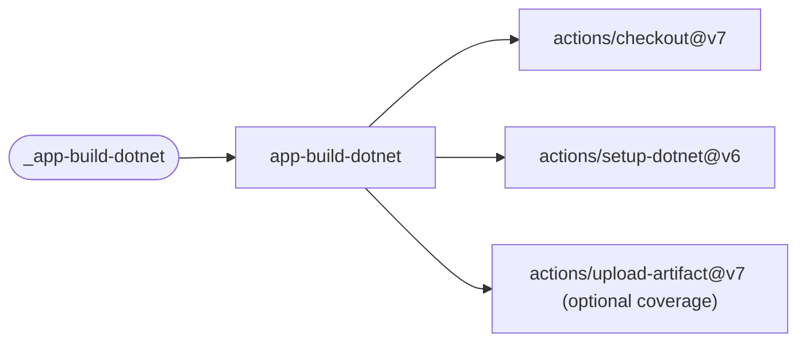

### _app-build-go

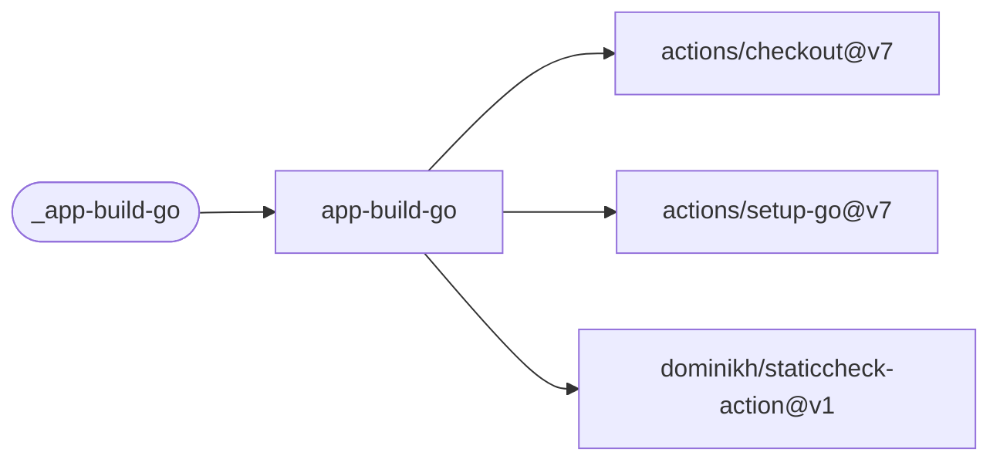

### _app-build-python


### _app-build-rust

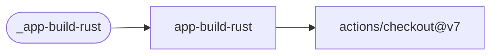

### deploy-maui-android

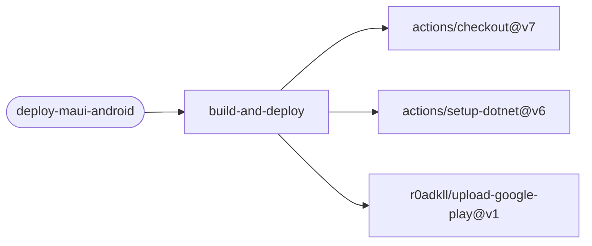

### _ef-migrations-drift

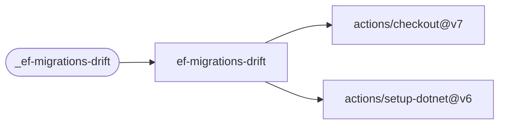

### _terraform

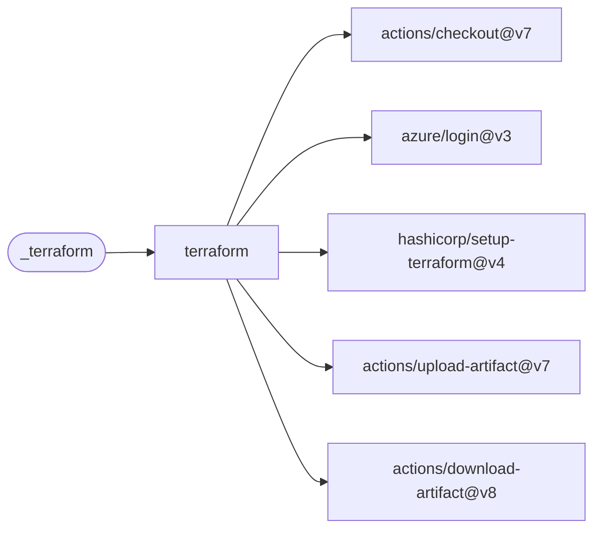

### _container-image-build

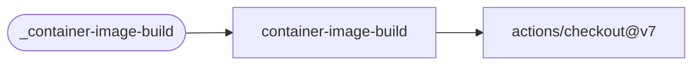

### _helm-chart-package

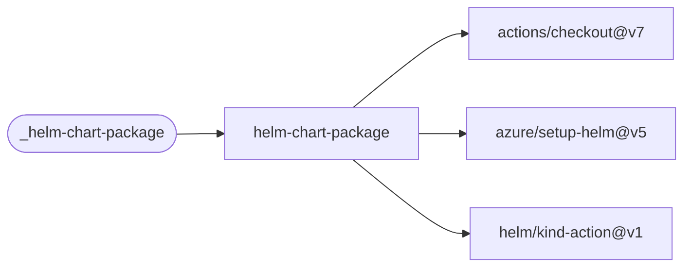

### _gitops-helm-update


### _gha-gitops-manifest-update

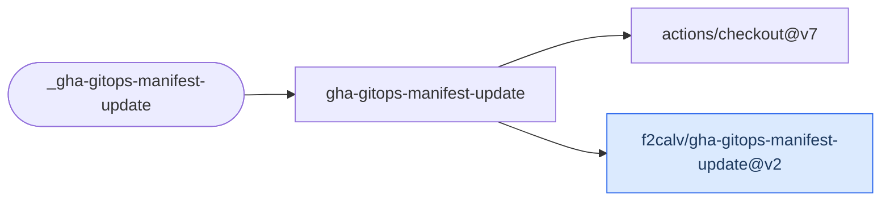

### _package-cleanup


### _gha-release-versioning


### _lint

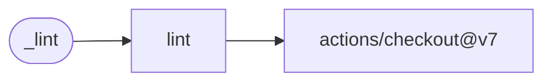

### _test

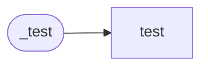

## Companion Actions

The release and GitOps wrappers call these companion composite Actions:

- [f2calv/gha-release-versioning](https://github.com/f2calv/gha-release-versioning) — Semantic versioning with GitVersion
- [f2calv/gha-gitops-manifest-update](https://github.com/f2calv/gha-gitops-manifest-update) — GitOps manifest image tag updates

For NuGet packaging and publication, call [gha-dotnet-nuget](https://github.com/f2calv/gha-dotnet-nuget)
as a step in your own job; it is not a dependency of the .NET build workflow.

## Other Resources

- [GitHub Actions Docs](https://docs.github.com/en/actions)
- [Reusing Workflows](https://docs.github.com/en/actions/using-workflows/reusing-workflows)
- [MIT license](LICENSE)
