# gha-workflows

`gha-workflows` provides reusable GitHub Actions workflows for application builds, validation, container and Helm publishing, Terraform operations and GitOps manifest updates. Repository maintainers call these workflows as jobs, rather than installing them as Marketplace Actions.

[](https://github.com/f2calv/gha-workflows/actions/workflows/ci.yml)

All reusable workflows are called via `workflow_call`. Shared build and validation workflows generally prefix the `name:` field with `_` (for example, `_app-build-dotnet`) to distinguish them from standalone workflows.

## Usage

Save this complete caller in your repository's `.github/workflows/build.yml`. It calculates a version without publishing, then passes the output into a .NET build:

```yaml
name: build
on: [push, pull_request]
permissions: {}
jobs:
  versioning:
    permissions:
      contents: read
    uses: f2calv/gha-workflows/.github/workflows/gha-release-versioning.yml@v1
    with:
      tag-and-release: false
      tag-prefix: ''
      move-major-tag: false

  build:
    needs: versioning
    permissions:
      contents: read
    uses: f2calv/gha-workflows/.github/workflows/app-build-dotnet.yml@v1
    with:
      version: ${{ needs.versioning.outputs.version }}
      solution-name: Example.slnx
```

Replace `Example.slnx` with your solution and provide `GitVersion.yml` in the caller. Tests require `global.json` selecting Microsoft.Testing.Platform and compatible test projects. Jobs calling reusable workflows do not also declare `steps` or `runs-on`; override the workflow's `runs-on` input instead. See [GitHub's reusable-workflow guidance](https://docs.github.com/en/actions/using-workflows/reusing-workflows).

Although it is not a Marketplace Action, this collection is released like one: immutable `vX.Y.Z` tags plus floating `vMAJOR` and `vMAJOR.MINOR` aliases. Replace `@v1` with an exact `@vX.Y.Z` tag from the [releases](https://github.com/f2calv/gha-workflows/releases) to lock one implementation.

## Workflows

### Application Build

| Workflow | Description | Key Inputs |
| --- | --- | --- |
| [App Build .NET](.github/workflows/app-build-dotnet.yml) | Restore, workload restore, build and test a .NET solution/project. Installs .NET 8/9/10 SDKs. Optionally collects coverage, provisions selected Compose services and clones extra repositories into the build context. | `version` (required), `runs-on`, `solution-name`, `configuration`, `execute-tests`, `test-solution-name`, `dotnet-restore-args`, `dotnet-build-args`, `dotnet-test-args`, `collect-coverage`, `coverage-artifact-name`, `test-compose-file`, `test-compose-services`, `extra-repos` |
| [App Build Go](.github/workflows/app-build-go.yml) | Check formatting and modules, run `go vet`, staticcheck, build and test a Go module. The toolchain version comes from `go.mod`. | `version` (required), `runs-on`, `go-version-file`, `working-directory`, `package`, `ldflags` |
| [App Build Python](.github/workflows/app-build-python.yml) | Validate the uv lockfile, restore all dependency groups, run Ruff, mypy and pytest, then build the Python package. `version` is exported to every step as `VERSION`. | `version` (required), `runs-on`, `working-directory` |
| [App Build Rust](.github/workflows/app-build-rust.yml) | Install the toolchain (honouring `rust-toolchain.toml`) with caching, check formatting, run Clippy, build and test a Rust project. `version` is exported to every Cargo step as `VERSION`. | `version` (required), `runs-on`, `working-directory`, `execute-tests` |

`dotnet-restore-args` and `dotnet-build-args` are split on whitespace only, like the container
`args`. `dotnet-test-args` is a JSON array so each argument remains distinct. For example,
`["--filter-class", "Example.Tests.CommandTests"]` uses an xUnit v3 filter rather than VSTest syntax.
The default is `[]`. The caller's test framework must support the supplied arguments.

Tests target `solution-name` by default. Set `test-solution-name` only when a different solution or
project must be tested independently.

`test-compose-services` is a JSON array such as `["database"]` of services to start before testing and stop afterward. Set
`test-compose-file` only when the repository does not use the default Compose filename.

Common build defaults: `runs-on: ubuntu-24.04`, .NET `configuration: Release`,
`execute-tests: true`, `collect-coverage: false`, `coverage-artifact-name: dotnet-coverage`.
Coverage is MTP XML, not the NuGet Action's cobertura/lcov pipeline. Unlike that Action, this
workflow honors `execute-tests: false` even on pull requests; callers own their required gates.
An extra .NET test target is restored and built separately. Coverage requires the caller's
test projects to reference `Microsoft.Testing.Extensions.CodeCoverage`; the workflow uploads
`TestResults/**/*.xml` with one-day retention and fails if no matching files exist.

Go uses `go.mod` by default, `working-directory: .`, `package: ./...`, `ldflags: ''`, injects `main.version`,
and runs race-enabled tests. Python expects a locked uv project containing Ruff, mypy and pytest.
Rust installs its toolchain with rustfmt and Clippy, caches the Cargo registry and target directory, and runs `cargo test --release` unless `execute-tests: false`.

Where supported, `extra-repos` is a JSON array of objects with `repo`, `ref`, and `path`,
for example `[{"repo":"example/dependency","ref":"main","path":"deps/dependency"}]`.
Cloning uses the [clone-extra-repos](.github/actions/clone-extra-repos/action.yml) action: a shallow
clone of `ref`, or of the default branch when `ref` is omitted, without persisting the token. The caller token
must actually have read access; the default token does not automatically grant access to another private repository.

### Mobile Deployment

| Workflow | Description | Key Inputs |
| --- | --- | --- |
| [Deploy MAUI Android](.github/workflows/deploy-maui-android.yml) | Publish a .NET MAUI Android app bundle, or sign it and upload it to Google Play. | `project` (required), `runs-on`, `target-framework` (`net10.0-android`), `deploy` (`false`), `dotnet-version` (`10.0.x`), `configuration` (`Release`), `package-name` (required to deploy), `play-track` (`internal`), `app-display-version` (`1.0`), `app-version-code` (`1`) |

### Database

| Workflow | Description | Key Inputs |
| --- | --- | --- |
| [EF Migrations Drift](.github/workflows/ef-migrations-drift.yml) | Fail when the EF Core model has schema changes not captured by a migration (runs `dotnet ef migrations has-pending-model-changes`; no live database required). Installs .NET 8/9/10 SDKs and restores tools. The caller repo must pin `dotnet-ef` in `.config/dotnet-tools.json` and provide an `IDesignTimeDbContextFactory` configured with the migrations provider. | `project` (required), `runs-on`, `startup-project`, `context`, `configuration`, `extra-repos` |

### Infrastructure

| Workflow | Description | Key Inputs |
| --- | --- | --- |
| [Terraform](.github/workflows/terraform.yml) | Backend-free `validate` or `test`, or Azure-backed `plan`, `apply`, `plan+apply`, `destroy`. A plan artifact can be consumed by another job in the same workflow run; no cross-run artifact ID is accepted. | `working-directory` (required), `runs-on`, `command` (`plan`), `terraform-version` (`1.13.3`), `environment`, `environment-files`, `backend-config`, `backend-config-file`, `azure-backend-key`, `var-file`, `azure-login` (`true`), `use-oidc` (`true`), `artifact-name` (`tfplan`), `log-level` (`ERROR`), `deployment-version`, `deployment-commit`, `deployment-layer`, `lock-id`, `state-rm`, `expected-release-tag`, `readme-path` (`README.md`) |

Terraform environment files contain scalar top-level key/value pairs, separated by newlines;
later files override earlier ones. Backend settings are one `key=value` per line; backend and
variable-file paths are relative to `working-directory`. Setting `azure-backend-key` requires
`TF_VAR_backend_resource_group_name`, `TF_VAR_backend_storage_account_name` and
`TF_VAR_backend_container_name` from the environment files. `expected-release-tag` checks a
README reference during validation. `lock-id` and `state-rm` are destructive state-recovery
controls, not ordinary validation inputs; `destroy` auto-approves.

### Containers & Helm

| Workflow | Description | Key Inputs |
| --- | --- | --- |
| [Container Image Build](.github/workflows/container-image-build.yml) | Multi-architecture buildx build and optional push; optional single-platform smoke test before the final build. Uses the caller's GitHub token for registry login, not independent ACR/Docker Hub credentials. No existing-tag conflict check enforces immutability. | `registry` (required), `tag` (required), `runs-on`, `repository`, `repository-prefix`, `dockerfile`, `buildkit-cache`, `default-branch-tag`, `feature-branch-tag`, `platform`, `args`, `default-branch`, `push-image`, `attestations`, `github-private-packages-auth`, `extra-repos`, `smoke-test`, `smoke-test-platform` |
| [Helm Chart Package](.github/workflows/helm-chart-package.yml) | Lint, package and push a Helm chart to an OCI registry. The Helm version comes from `.devcontainer/devcontainer.json`; chart testing can use lint, KIND-backed install or skip mode. | `tag` (required), `image-registry` (required), `image-repository` (required), `chart-registry` (required), `chart-repository` (required), `runs-on`, `tag-override`, `chart-path`, `is-library-chart`, `set-chart-app-version`, `has-image`, `push-chart`, `chart-registry-username`, `chart-dependency-name`, `chart-testing-cli-command`, `chart-testing-cli-version` |
| [GitOps Helm Update](.github/workflows/gitops-helm-update.yml) | Update image and chart coordinates in ArgoCD Helm manifests, then optionally commit them to a GitOps repository. Requires `GH_PAT_GITOPS`. | `manifest-paths` (required), `tag` (required), `namespace` (required), `image-registry` (required), `image-repository` (required), `gitops-repo` (required), `runs-on`, `tag-override`, chart coordinates, Git controls, `devcontainer-path`, `environment` |
| [Package Cleanup](.github/workflows/package-cleanup.yml) | Prune old container and Helm chart versions from ghcr.io via [dataaxiom/ghcr-cleanup-action](https://github.com/dataaxiom/ghcr-cleanup-action). Keeps the N most-recent tagged versions, deletes untagged orphans, and protects excluded tags. Defaults to dry-run. | `packages` (required), `runs-on`, `keep-n-tagged`, `exclude-tags`, `older-than`, `delete-untagged`, `dry-run` |

Container defaults: context `.`, `dockerfile: Dockerfile`, `platform: linux/amd64,linux/arm64,linux/arm/v7`,
`push-image: true`, `attestations: false`, `buildkit-cache: false`, `default-branch: refs/heads/main`, alias tags
`latest` / `latest-dev`, and `smoke-test-platform: linux/amd64`. The default repository is
the lowercased caller repository name **without the owner**; supply a full
`repository: ${{ github.repository }}` for GHCR. Registry login still runs with `push-image: false`.
Registry, repository and tags are lowercased and validated; an invalid value fails the job.
The smoke-test command receives `$IMAGE`. `args` is split on whitespace only: quotes are not
interpreted and nothing is expanded, so a single argument cannot contain a space.

Helm always logs in, even with `push-chart: false`. It reads the Helm version from
`.devcontainer/devcontainer.json` and needs Docker, `jq`, Node/npm and `yq` on the runner.
Set a concrete `chart-path`, whose basename must equal `Chart.yaml`'s name and the final
segment of `chart-repository`, such as `example/charts/example-app`. The default `./charts/`
is not a chart-discovery mechanism. Packaging changes chart version, optional appVersion,
image values and optionally a named dependency. `is-library-chart: true` skips rendering
and install testing; `has-image: false` avoids image-value rewriting.
`chart-testing-cli-command` accepts `lint` (default), `install`, which creates a KIND cluster,
or `skip`, which relies on the `helm lint` run during packaging. `chart-testing-cli-version`
pins the chart-testing image, default `v3.15.0`. The registry password is always the caller's
`GITHUB_TOKEN`. Inputs are validated before use, and OCI coordinates and the image tag are
lowercased to match the published image; an invalid value fails the job.

The GitOps workflow checks out the target repository and calls the manifest-update Action, which
validates that each Argo CD chart renders and commits only the updated manifests.
`gitops-repo-update: false` disables Git commit/push operations, not the manifest edits.
`gitops-repo-branch` is forwarded to the Action, not checkout's `ref`; configure the target
carefully. The chart registry password is always the caller's `GITHUB_TOKEN`.
`manifest-paths` is a space-separated list of YAML paths, not a JSON array.

Cleanup's `packages` is a comma-separated list without the owner, such as
`example-app,charts/example-app`. Defaults retain 10 tagged versions, protect `latest`,
delete untagged versions, omit an age filter and use `dry-run: true`. Excluded tag patterns
take precedence; opt out of dry-run only when the caller intends real deletion.

### NuGet Libraries

| Workflow | Description | Key Inputs |
| --- | --- | --- |
| [.NET NuGet Library](.github/workflows/dotnet-nuget-library.yml) | Complete library CI: lint, versioning, build/test/pack/push through [gha-dotnet-nuget](https://github.com/f2calv/gha-dotnet-nuget), then a `major.minor.patch` release when none exists. Test services are not supported yet. | `runs-on`, `solution-name`, `configuration`, `execute-tests`, `code-coverage`, `dotnet-test-args`, `dotnet-restore-args`, `push-preview`, `package-filter`, `nuget-user`, `release` (`true`) |

Call it as the only job and grant the union of its permissions: `contents: write`, `id-token: write` and `packages: write`.

### Release & Versioning

| Workflow | Description | Key Inputs |
| --- | --- | --- |
| [Release Versioning](.github/workflows/gha-release-versioning.yml) | Determine a semantic version via GitVersion, publish its tag and optionally create a GitHub Release. | `runs-on`, `semVer`, `tag-prefix`, `move-major-tag`, `tag-and-release`, `tag-only`, `release-branch`, `gv-config`, `gv-source` |

Release defaults are `semVer: ''`, `tag-prefix: v`, `move-major-tag: true`,
`tag-and-release: true`, `gv-config: GitVersion.yml`, `gv-source: actions`.
For non-Action repositories override **both** `tag-prefix: ''` and `move-major-tag: false`.
Use `tag-and-release: false` for calculation-only jobs. The companion Action's current
alias switch moves both major and minor aliases, not just the major; do not enable it
when you require major-only Action aliases. See its [documented limitation](https://github.com/f2calv/gha-release-versioning#publishing).

### Code Quality

| Workflow | Description | Key Inputs |
| --- | --- | --- |
| [Helm Lint](.github/workflows/helm-lint.yml) | `helm dependency build` and `helm lint` each chart, then lint it against every `ci/*-values.yaml` fixture. The Helm version comes from `.devcontainer/devcontainer.json` unless overridden. | `charts` (required JSON array), `runs-on`, `require-ci-values` (`true`), `helm-version`, `devcontainer-path` |
| [README Reference Check](.github/workflows/readme-ref-check.yml) | Fail when the README does not reference the exact floating major tag, so `@v2.1` cannot satisfy `@v2`. The default pattern matches the calling repository as an Action (`owner/action@vN`). | `major` (required), `runs-on`, `reference-prefix`, `readme-path` |
| [Lint](.github/workflows/lint.yml) | Run [pre-commit](https://pre-commit.com/) hooks against all files in the repository, caching hook environments by configuration. | `runs-on`, `pre-commit-version` |

## Permissions and Secrets

Callers must grant at least the permissions the callee needs: nested workflows cannot elevate
the caller token. `GITHUB_TOKEN` is automatically available; it is not a secret you need to
redeclare in `workflow_call`. Use `secrets: inherit` only for trusted calls needing repository
secrets, or explicitly map declared secrets. Environment-scoped secrets are resolved by jobs
that select an environment, subject to its protection rules.

| Workflow | Caller token permissions | Additional credentials |
| --- | --- | --- |
| .NET, Go, Python, Rust builds; EF drift; lint; Helm lint; README check | `contents: read` | None for ordinary public source; extra repository reads need actual repository access |
| Container image build | `contents: read`, `packages: write` for GHCR push (`read` for private pulls) | Uses `GITHUB_TOKEN` for login; no separate registry secret contract |
| Helm chart package | `contents: read`, `packages: write` (callee declares both, even with `push-chart: false`) | Uses `GITHUB_TOKEN` as chart password; set `chart-registry-username` |
| GitOps Helm update | `contents: read`, `packages: read` | Required declared `GH_PAT_GITOPS` with target-repository read/write access for checkout and commits |
| Package cleanup | `packages: write` | Default token must administer the target owner's packages |
| Release calculation / publication | `contents: read` / `contents: write` | Automatic token; full authenticated history is checked out internally |
| Terraform | `contents: read`, `id-token: write` (validated at startup for every command, including `validate` and `test`) | For Azure operations: `ARM_TENANT_ID`, `ARM_SUBSCRIPTION_ID`, `ARM_CLIENT_ID`; additionally `ARM_CLIENT_SECRET` when `use-oidc: false` |
| .NET NuGet library | `contents: write`, `id-token: write`, `packages: write` | Automatic token; nuget.org Trusted Publishing when `nuget-user` is set |
| MAUI Android | `contents: read` | With `deploy: true`, map the declared `ANDROID_KEYSTORE_BASE64`, `ANDROID_KEYSTORE_PASSWORD`, `ANDROID_KEY_ALIAS`, `ANDROID_KEY_PASSWORD` and `GOOGLE_PLAY_SERVICE_ACCOUNT_JSON` secrets |

MAUI signing secrets reach MSBuild as environment variables, never as command-line properties.
Unsigned MAUI validation needs no signing credentials. Container, Helm, GitOps and MAUI workflows
skip Dependabot actors. Publication and Terraform state mutations are not universally event-gated:
callers must restrict those jobs to trusted events and appropriate environments.

## Outputs

Only the release workflow declares reusable-workflow outputs:

| Output | Meaning |
| --- | --- |
| `version` | GitVersion FullSemVer or supplied `semVer` |
| `major`, `minor`, `patch` | Individual version components |
| `release-exists` | String `true` / `false` indicating a GitHub Release, not merely a tag |

Consume them through `needs.<job-id>.outputs.<name>` as in the usage example.
Other workflows return job success/failure and side effects, not named job outputs:
.NET optionally uploads MTP XML coverage, Terraform `plan` uploads binary/text plan artifacts,
container/Helm jobs can publish registry artifacts, and GitOps jobs can push commits.
Do not expect the NuGet companion Action's output or package publishing from `app-build-dotnet`.

## Data Flow

These execution paths are the product, not this repository's own release pipeline:

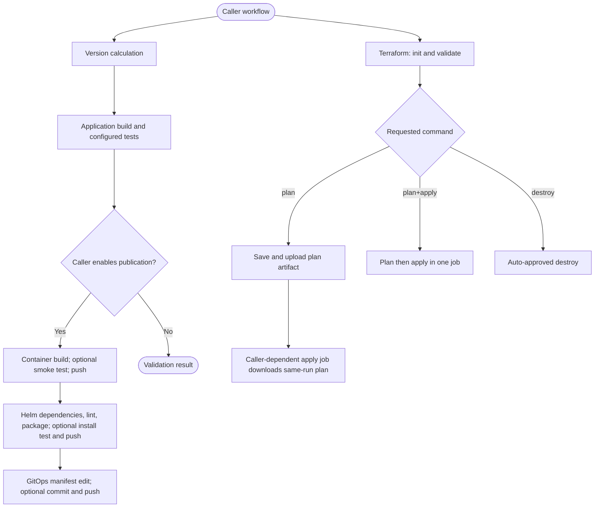

Edges between separate workflows are **caller-owned** `needs` relationships, not automatic
orchestration. Terraform `validate` initializes with `-backend=false` and does not authenticate
to Azure or contact a live database; provider/module downloads may still need network access.

## Deployment Flow

Mermaid diagrams showing the action dependency chain for each workflow. Actions and workflows owned by [f2calv](https://github.com/f2calv) are highlighted in blue.

### _app-build-dotnet

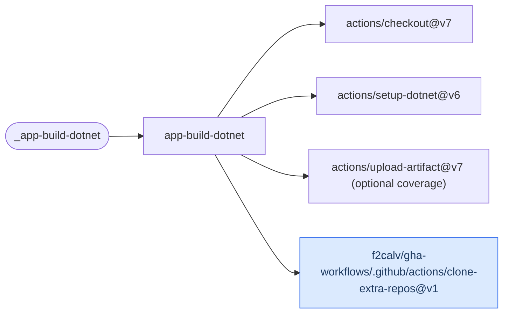

### _app-build-go


### _app-build-python

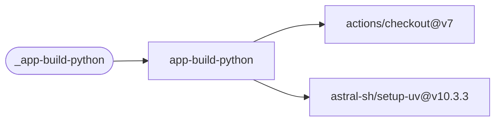

### _app-build-rust

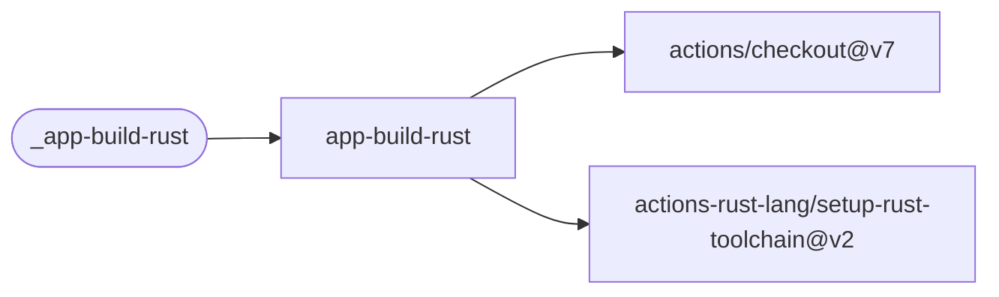

### _deploy-maui-android

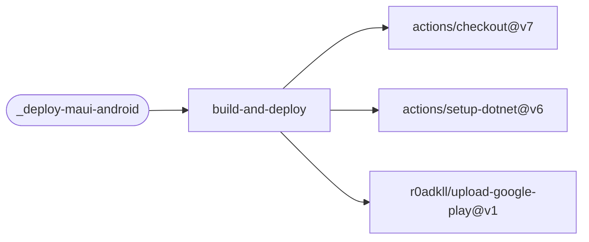

### _ef-migrations-drift

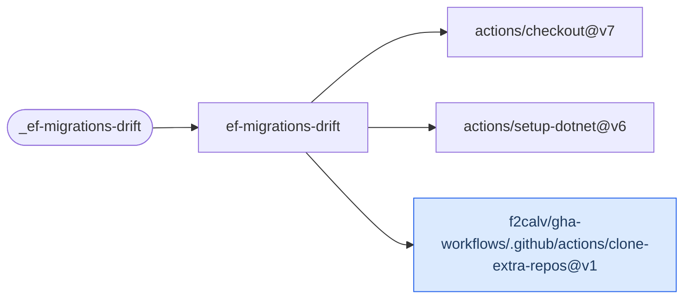

### _terraform


### _container-image-build

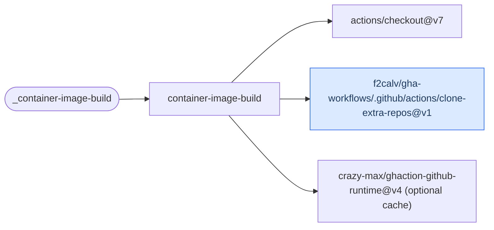

### _helm-chart-package

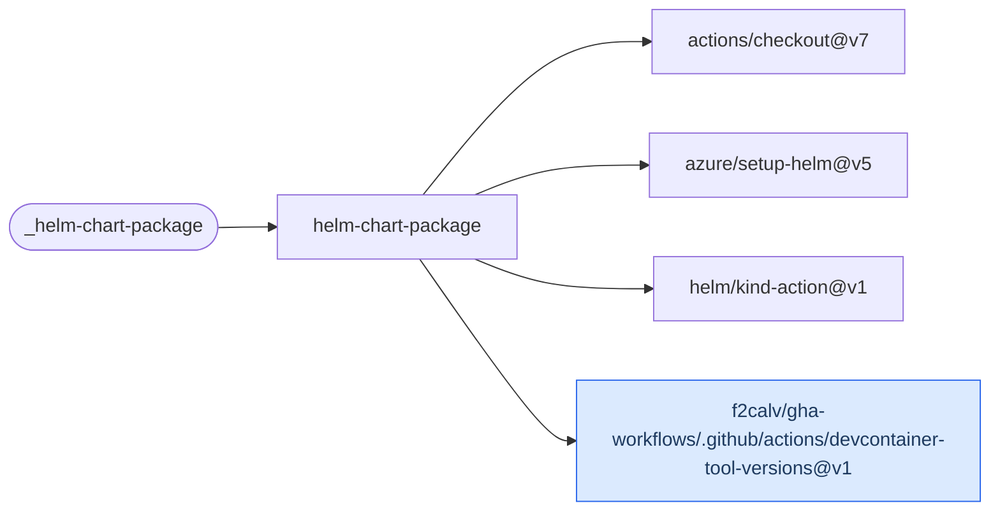

### _gitops-helm-update

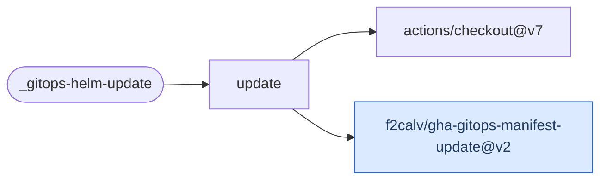

### _package-cleanup

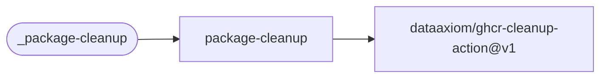

### _gha-release-versioning

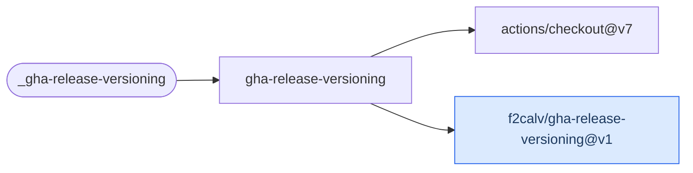

### _helm-lint

```mermaid
graph LR
    classDef f2calv fill:#dbeafe,stroke:#2563eb,color:#1e3a5f
    W(["_helm-lint"]) --> J["helm (chart)"]
    J --> A1["actions/checkout@v7"]
    J --> A2["azure/setup-helm@v5"]
    J --> A3["f2calv/gha-workflows/.github/actions/devcontainer-tool-versions@v1"]
    class A3 f2calv
```n
### _readme-ref-check

```mermaid
graph LR
    classDef f2calv fill:#dbeafe,stroke:#2563eb,color:#1e3a5f
    W(["_readme-ref-check"]) --> J["readme-ref-check"]
    J --> A1["actions/checkout@v7"]
```n
### _dotnet-nuget-library

```mermaid
graph LR
    classDef f2calv fill:#dbeafe,stroke:#2563eb,color:#1e3a5f
    W(["_dotnet-nuget-library"]) --> L(["_lint"])
    W --> V(["_gha-release-versioning"])
    W --> J["build"]
    J --> A1["f2calv/gha-dotnet-nuget@v2"]
    W --> R(["_gha-release-versioning (release)"])
    class A1 f2calv
```n
### _lint

```mermaid
graph LR
    classDef f2calv fill:#dbeafe,stroke:#2563eb,color:#1e3a5f
    W(["_lint"]) --> J["lint"]
    J --> A1["actions/checkout@v7"]
    J --> A2["actions/cache@v6"]
```

## Self-Tests

This repository's CI calls its own reusable workflows from the commit under review against small
fixtures in [tests/fixtures](tests/fixtures), before a release moves the floating major alias:

| Workflow | Fixture | Exercises |
| --- | --- | --- |
| `app-build-dotnet.yml` | .NET library and xUnit v3 tests | Restore, build, Microsoft.Testing.Platform tests and coverage upload |
| `container-image-build.yml` | Minimal multi-architecture image | Default platforms, BuildKit cache and the smoke test; never pushed |
| `helm-chart-package.yml` | Chart that owns an image value | Image rewriting, packaging and `ct lint`; never pushed |
| `app-build-rust.yml` | Cargo binary with a unit test | `working-directory`, toolchain setup, fmt, Clippy, build and tests |
| `app-build-python.yml` | Locked uv package | Lockfile check, Ruff, mypy, pytest and `uv build` |
| `app-build-go.yml` | Go module outside the repository root | `working-directory`, vet, staticcheck, build and race tests |
| `terraform.yml` | Root module with one output and a test file | Backend-free `validate`, `fmt` and `terraform test` |
| `helm-lint.yml` | The chart fixture and its `ci/` values | Devcontainer Helm version, dependency build and fixture lint |
| `dotnet-nuget-library.yml` | The .NET fixture with `release: false` | Nested lint, versioning and gha-dotnet-nuget build and tests |
| `readme-ref-check.yml` | This README | The floating major reference for this repository's workflows |
| `devcontainer-tool-versions` action | This repository's devcontainer | Helm and yq versions read without modifying the file |
| `ef-migrations-drift.yml` | Model-less EF Core context with a design-time factory | Tool restore and the pending-model-changes check |
| `clone-extra-repos` action | Two public repositories | Ref and default-branch clones without persisted credentials |

The root `global.json`, `.config/dotnet-tools.json` and the Helm version in
`.devcontainer/devcontainer.json` exist for these fixtures, matching what the workflows require
from a caller.

## Composite Actions

[clone-extra-repos](.github/actions/clone-extra-repos/action.yml) shallow-clones the repositories
in an `extra-repos` JSON array. Its token is sent as a per-command header, so it never reaches a
remote URL or `.git/config` that a container build context could copy. An omitted `ref` clones the
default branch.

[devcontainer-tool-versions](.github/actions/devcontainer-tool-versions/action.yml) reads the
`helm` and `yq` versions pinned in a JSONC `devcontainer.json` into outputs, from a temporary copy so
the checkout is never modified.

## Companion Actions

The release and GitOps wrappers call these companion composite Actions:

- [f2calv/gha-release-versioning](https://github.com/f2calv/gha-release-versioning) — Semantic versioning with GitVersion
- [f2calv/gha-gitops-manifest-update](https://github.com/f2calv/gha-gitops-manifest-update) — GitOps manifest image tag updates

For NuGet packaging and publication, call [gha-dotnet-nuget](https://github.com/f2calv/gha-dotnet-nuget)
as a step in your own job; it is not a dependency of the .NET build workflow.

## Other Resources

- [GitHub Actions Docs](https://docs.github.com/en/actions)
- [Reusing Workflows](https://docs.github.com/en/actions/using-workflows/reusing-workflows)
- [MIT license](LICENSE)
