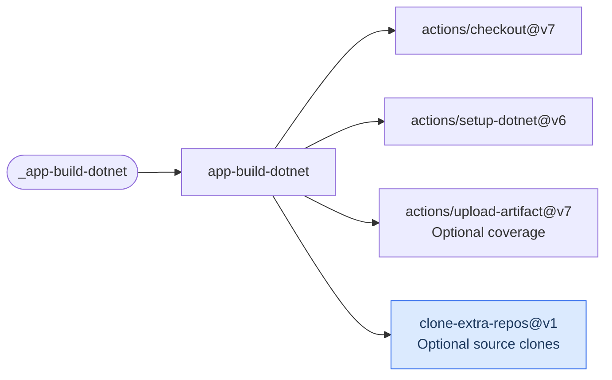

# App Build .NET

Restore workloads, restore dependencies, build and optionally test a .NET solution or project.
This workflow does not pack or publish NuGet packages.

[Workflow catalogue](../README.md) | [Workflow source](../.github/workflows/app-build-dotnet.yml)

## Key Inputs

| Inputs | Contract |
| --- | --- |
| `version` | Required build version; also stamps source and workflow provenance. |
| `runs-on`, `configuration`, `solution-name` | Default runner `ubuntu-26.04`, configuration `Release`; an empty solution uses the checkout root. |
| `dotnet-restore-args`, `dotnet-build-args` | Whitespace-separated arguments, without shell quote parsing or expansion. |
| `execute-tests`, `test-solution-name`, `dotnet-test-args` | Tests default to enabled and use the build target. An optional different test target is restored and built separately. Test arguments are a JSON array of strings, default `[]`. |
| `collect-coverage`, `coverage-artifact-name` | Coverage defaults to disabled; the artifact name defaults to `dotnet-coverage`. |
| `test-compose-file`, `test-compose-services` | Optional Compose file and JSON array of service names, default `[]`; services are started only when tests are enabled. |
| `extra-repos` | Optional repository clones; see the [shared caller contract](calling-workflows.md#extra-repositories). |

## Usage

Add this job to a caller with a `versioning` job, as in the [quick start](../README.md#quick-start):

```yaml
build:
  needs: versioning
  permissions:
    contents: read
  uses: f2calv/gha-workflows/.github/workflows/app-build-dotnet.yml@v1
  with:
    version: ${{ needs.versioning.outputs.version }}
    solution-name: Example.slnx
    dotnet-test-args: '["--filter-class", "Example.Tests.CommandTests"]'
```

## Tests And Coverage

The caller needs `global.json` selecting `Microsoft.Testing.Platform` and compatible test
projects. Filter arguments must match the caller's test framework; the example uses xUnit v3,
not VSTest syntax. `execute-tests: false` is honored even on pull requests; callers own their
required gates.

Coverage requires `Microsoft.Testing.Extensions.CodeCoverage` in the test projects. It uploads
`TestResults/**/*.xml` with one-day retention and fails if no matching files exist. This is
MTP XML coverage, not the NuGet companion Action's cobertura/lcov pipeline. There are no named
reusable-workflow outputs.

`test-compose-services` accepts values such as `["database"]`. The workflow waits for those
services before testing and tears them down afterward, including their volumes. Set
`test-compose-file` only when the caller does not use the default Compose filename.

## Permissions And Prerequisites

Grant `contents: read`. Extra repository clones require actual repository read access. The
workflow installs .NET SDKs 10 and 11; the caller's SDK selection must be compatible.
Compose tests additionally need Docker and the declared services on the runner.

## Deployment Flow

The job uses these actions; they are dependencies, not a sequence of execution steps.
The blue action is maintained in this repository.



  Repositories: [checkout](https://github.com/actions/checkout),
  [setup-dotnet](https://github.com/actions/setup-dotnet),
  [upload-artifact](https://github.com/actions/upload-artifact),
  [clone-extra-repos](../.github/actions/clone-extra-repos/action.yml).
