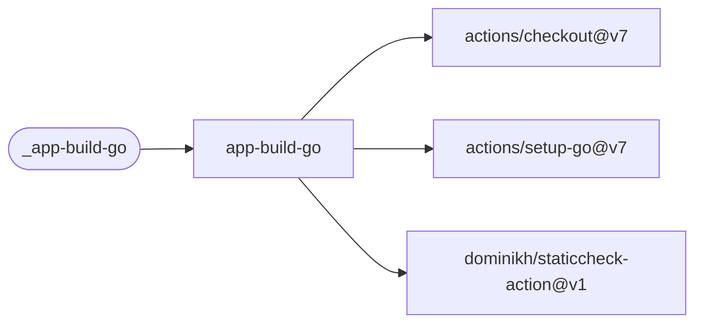

# App Build Go

Check formatting and modules, run vet and staticcheck, build and run race-enabled Go tests.

[Workflow catalogue](../README.md) | [Workflow source](../.github/workflows/app-build-go.yml)

## Key Inputs

| Input | Contract |
| --- | --- |
| `version` | Required; injected into `main.version`. |
| `runs-on` | Default `ubuntu-26.04`. |
| `go-version-file` | Default `go.mod`; selects the toolchain. |
| `working-directory` | Default `.`; Go commands run here. |
| `package` | Default `./...`. |
| `ldflags` | Additional linker flags; default empty. |

## Permissions And Results

Grant `contents: read`. The caller needs a Go module and code that supports race-enabled tests.
The workflow returns success/failure, not named outputs or a published package.
Use the [shared caller pattern](calling-workflows.md) to pass a calculated version.

## Deployment Flow

The build job depends on these checkout, toolchain and static-analysis actions.

Repositories: [checkout](https://github.com/actions/checkout),
[setup-go](https://github.com/actions/setup-go),
[staticcheck-action](https://github.com/dominikh/staticcheck-action).
