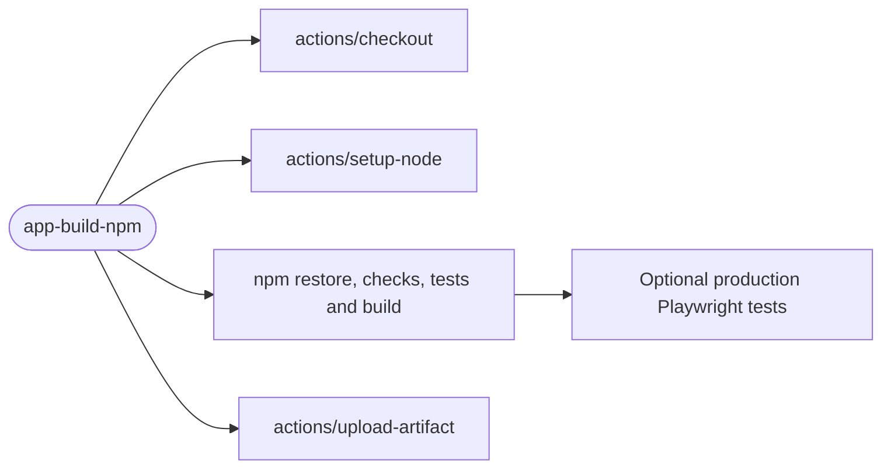

# npm Application Build

Build browser-only npm applications with a locked restore and credential-free validation.
The workflow uploads the tested `dist` directory as a normal Actions artifact, not a deployment.

[Workflow catalogue](../README.md) · [Workflow source](../.github/workflows/app-build-npm.yml)

## Contract

The project supplies `.nvmrc`, `package-lock.json` and scripts named `format:check`, `lint`,
`typecheck`, `test` and `build`. The test command must fail on zero tests. Builds write only
publishable public assets to `dist`. Enable `browser-tests` for projects with a
`test:browser` script and locally installed Playwright; Chromium and its Linux dependencies
are installed before testing the production output.

| Input | Default | Purpose |
| --- | --- | --- |
| `version` | Required | Build identity forwarded as `APP_VERSION` and `VITE_APP_VERSION`. |
| `base-path` | `/` | Hosting path forwarded as `VITE_BASE_PATH`, including the trailing slash. |
| `working-directory` | `.` | npm application root. |
| `node-version-file` | `.nvmrc` | Relative to that application root. |
| `browser-tests` | `false` | Run production Playwright Chromium tests. |
| `artifact-name` | `frontend` | Normal artifact containing `dist` only. |
| `retention-days` | `7` | Artifact retention. |
| `runs-on` | `ubuntu-26.04` | Runner. |

Only `contents: read` is required. No deployment secrets are used and no publication occurs.
The `artifact-name` output identifies the tested output. Version and base are build inputs, not
automatic package-manifest edits: the application embeds them using its bundler configuration.
This contract currently supports npm, not pnpm/Yarn or server-side Node deployments.

## Consumer

```yaml
build:
  needs: versioning
  uses: f2calv/gha-workflows/.github/workflows/app-build-npm.yml@v1
  permissions:
    contents: read
  with:
    version: ${{ needs.versioning.outputs.version }}
    base-path: /${{ github.event.repository.name }}/
    browser-tests: true
```

Configure browser tests to navigate relative to the hosting base and verify manifest, icons,
worker scope and offline refresh there. Build success at `/` is not evidence of subpath support.
Publish the same artifact through [Pages publishing](pages-publish.md); never rebuild at deploy time.

## Deployment Flow



The dependency-free fixture verifies the script contract, version/base propagation and artifact
contents. The real frontend caller exercises Playwright and PWA behavior; fixture coverage alone
does not prove browser compatibility.
