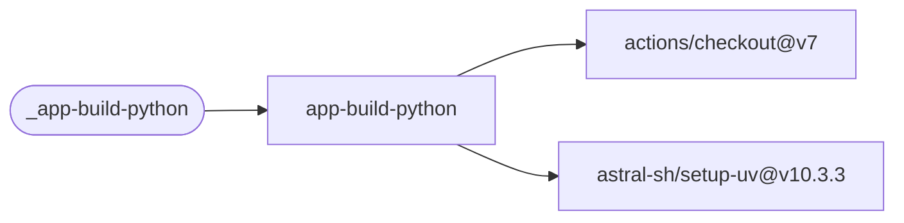

# App Build Python

Validate a uv lockfile, restore all dependency groups, run Ruff, mypy and pytest, then build
the Python package with `uv build`.

[Workflow catalogue](../README.md) | [Workflow source](../.github/workflows/app-build-python.yml)

## Key Inputs

| Input | Contract |
| --- | --- |
| `version` | Required; exported to every step as `VERSION`. |
| `runs-on` | Default `ubuntu-26.04`. |
| `working-directory` | Default `.`; uv and validation commands run here. |

## Permissions And Results

Grant `contents: read`. The caller needs a locked uv project containing Ruff, mypy and pytest.
The workflow builds the package locally; it does not publish it or declare named outputs.
Use the [shared caller pattern](calling-workflows.md) to pass a calculated version.

## Deployment Flow

The build job uses checkout and uv setup; validation commands run inside the job.

Repositories: [checkout](https://github.com/actions/checkout),
[setup-uv](https://github.com/astral-sh/setup-uv).
