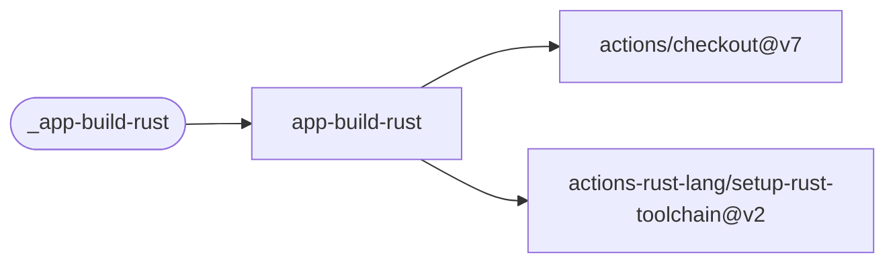

# App Build Rust

Install a Rust toolchain with caching, check formatting, run Clippy, build and optionally test
a Cargo project.

[Workflow catalogue](../README.md) | [Workflow source](../.github/workflows/app-build-rust.yml)

## Key Inputs

| Input | Contract |
| --- | --- |
| `version` | Required; exported to every Cargo step as `VERSION`. |
| `runs-on` | Default `ubuntu-26.04`. |
| `working-directory` | Default `.`; Cargo commands run here. |
| `execute-tests` | Default `true`; runs `cargo test --release`. |

## Permissions And Results

Grant `contents: read`. Toolchain setup honors `rust-toolchain.toml`, includes rustfmt and
Clippy, and caches the Cargo registry and target directory. There are no named outputs or
package-publication steps. Use the [shared caller pattern](calling-workflows.md).

## Deployment Flow

The build job depends on checkout and the cached Rust toolchain action.

Repositories: [checkout](https://github.com/actions/checkout),
[setup-rust-toolchain](https://github.com/actions-rust-lang/setup-rust-toolchain).
