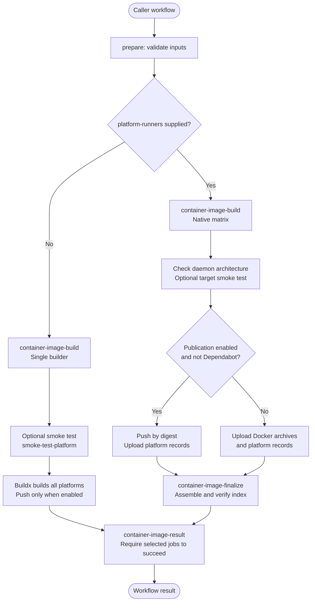
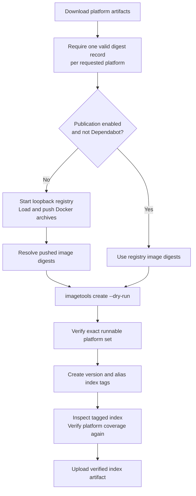
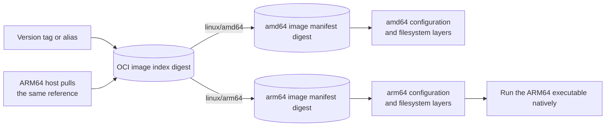
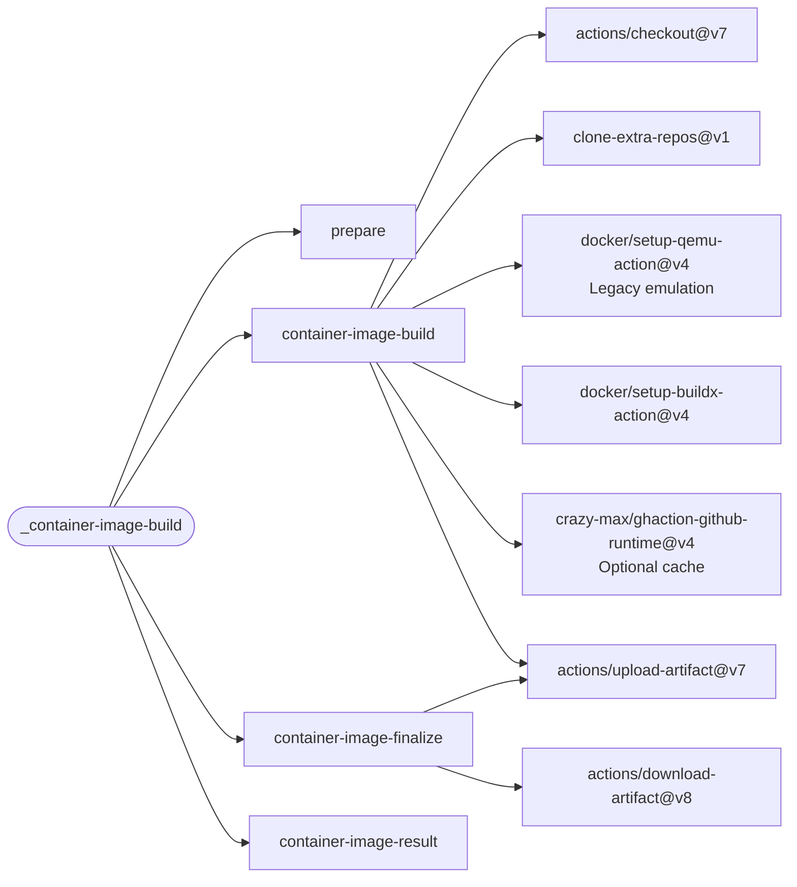

# Container Image Architecture

The [container image workflow](../.github/workflows/container-image-build.yml) accepts one
Dockerfile and publishes one image reference for the requested platforms. Native AOT changes
where compilation happens, not how consumers pull the resulting multi-platform image.

Native AOT also supports [cross-compilation with an appropriate target toolchain](https://learn.microsoft.com/dotnet/core/deploying/native-aot/cross-compile).
Split native runners are a scheduling strategy, not a requirement of OCI indexes or every AOT build.

This describes the current checkout. Use the split-runner example only with a release or commit
that contains the `platform-runners` contract; an older `@v1` implementation may not accept it.

## Build Activity

An empty `platform-runners` selects the existing single-builder path. A non-empty mapping
selects parallel native jobs and an explicit finalization job.



The aggregate gate runs even after failure or cancellation. Finalization must succeed in native
mode; its intentional skip is accepted only in single-builder mode. A failed native job prevents
finalization and therefore prevents publishing the combined version and alias tags. Images
already uploaded by digest can remain in the registry after a failure.

## Index Assembly Activity

Only native mode runs this job. The registry used for assembly changes with publication mode;
the platform-coverage checks and index-creation steps are shared.



No compilation happens during finalization. In no-publication mode the tags exist only in the
disposable registry, which is removed when the step exits.

## Data Flow

An OCI image index is a small document referencing per-platform image manifests. Combining
images does not merge their executables or copy their layers into one filesystem.



For example, an ARM64 host pulling `ghcr.io/owner/app:1.2.3` selects the ARM64 descriptor.
Pinning the index digest instead of its tag still permits platform selection. Pinning a child
image digest selects only that particular platform image.

## Calling The Workflow

This excerpt assumes the caller has a `versioning` job. The caller controls publication; the
workflow's `push-image` default is `true`, not an implicit pull-request safety policy.

```yaml
image:
  needs: versioning
  uses: f2calv/gha-workflows/.github/workflows/container-image-build.yml@v1
  permissions:
    contents: read
    packages: write
  with:
    registry: ghcr.io/${{ github.repository_owner }}
    tag: ${{ needs.versioning.outputs.version }}
    platform: linux/amd64,linux/arm64
    platform-runners: >-
      [{"platform":"linux/amd64","runner":"ubuntu-26.04"},
      {"platform":"linux/arm64","runner":"ubuntu-26.04-arm"}]
    artifact-name: app-native-image
    buildkit-cache: true
    push-image: ${{ github.event_name == 'push' && github.ref == format('refs/heads/{0}', github.event.repository.default_branch) }}
```

Omit `platform-runners` for single-builder cross-compilation or emulation. A native mapping must
cover every requested platform exactly once. Runner values may be labels or label arrays;
caller-controlled variables can supply self-hosted labels without embedding infrastructure
identities in a public workflow. Do not run untrusted pull-request code on privileged cluster
runners.

The native workflow currently accepts Linux amd64, arm64 and arm/v7 mappings. The Dockerfile
and its toolchain may support fewer targets: the AOT fixture supports amd64 and arm64 only.
`runs-on` selects the preparation, finalization and aggregate jobs; mapped runners select the
native build jobs. One Dockerfile is used by every build job.

## Artifact And Cache Contracts

| Mode | Build output | Finalization | Smoke-test platform |
| --- | --- | --- | --- |
| Single builder | Build cache, or tagged registry output when publication is enabled | No separate finalization job | `smoke-test-platform` |
| Native with publication | Registry images addressed by digest plus small JSON artifacts | Combine immutable digest references into one index | Each native target |
| Native without publication | Docker archive and JSON record for each platform | Load into a disposable local registry and verify the combined index | Each native target |

Choose a unique `artifact-name` for each native call in the same caller workflow. Platform
artifacts use `<artifact-name>-linux-*`; verified index evidence uses `<artifact-name>-index`
and is not downloaded as an input to finalization. Artifacts are retained for one day.

Native cache scopes include the repository and platform key, preventing architecture jobs from
overwriting one another's cache scope. This is a BuildKit layer cache; it does not automatically
persist every Dockerfile cache mount on a newly provisioned runner.

No-publication finalization needs an isolated Docker daemon with loopback port 5000 available.
It does not log in to GHCR or export attestations. Publication can attach attestations when
enabled; verification excludes their `unknown` platform descriptors from the runnable platform
set. Existing-tag immutability is not enforced by this workflow.

## Deployment Flow

The dependency graph shows actions used inside the workflow, distinct from the execution and
artifact flows above. The optional clone action is maintained in this repository.



## Validation Boundary

The [CI callers](../.github/workflows/ci.yml) cover vanilla amd64, legacy amd64/arm64/arm/v7,
and split-runner amd64/arm64 AOT builds, plus runner-mapping validation. The
[AOT fixture](../tests/fixtures/container-aot/Dockerfile) refuses a non-native build platform
and reports process architecture and dynamic-code support.

Local amd64 AOT and local index-assembly checks do not establish ARM64 runner availability,
GitHub artifact transfer or GHCR authentication. Those require a successful run of the
same-commit CI callers on GitHub. They also do not deploy or establish application readiness.