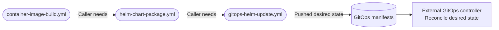
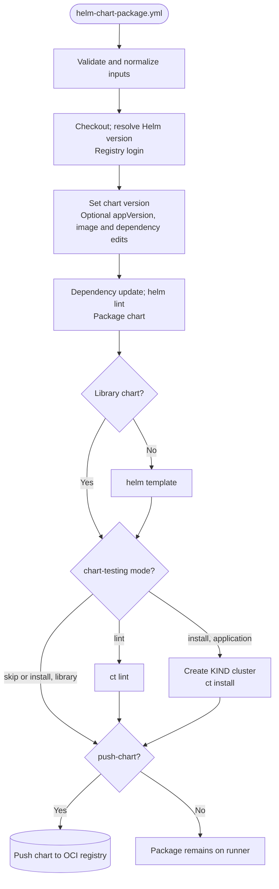
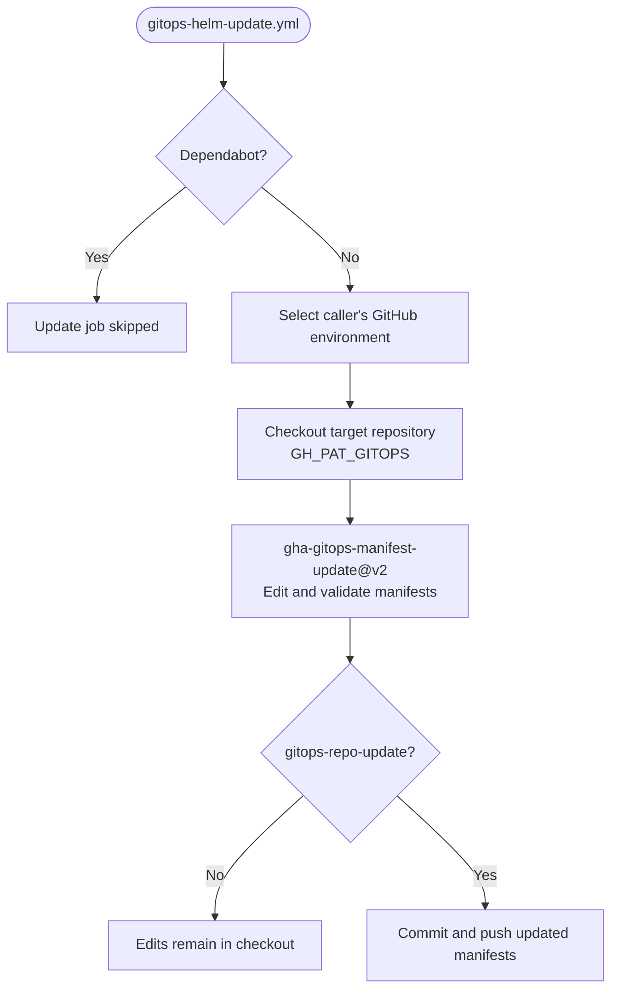

# Helm And GitOps Architecture

The [Helm package workflow](../.github/workflows/helm-chart-package.yml) validates and packages
a chart. The [GitOps update workflow](../.github/workflows/gitops-helm-update.yml) edits a
separate manifest checkout. Neither workflow automatically calls the other.

## Deployment Flow

These dependencies belong to the caller. An image build does not publish a chart, and a chart
push does not deploy it.



Guard publication and the GitOps call explicitly in the caller. For split native images, wait
for the complete image workflow, including its `container-image-result` gate, before packaging
a chart intended to reference the new image index. An index tag and chart version are separate
artifacts even when they share the same version string.

## Chart Packaging Activity

Packaging always performs `helm lint`. Additional chart-testing behavior depends on the mode
and whether the chart is an application or a library.



`push-chart: false` disables the final push, not registry login, dependency downloads, file
rewrites or chart tests. There is no package-artifact upload step. Library charts skip rendering
and install tests, but still package and lint. With `has-image: false`, image values are not
rewritten; registry inputs remain required by the workflow contract.

With install mode, `push-chart: false` and `has-image: true`, the test substitutes the public
`nginx:latest` image. This proves chart installation with a placeholder, not startup of the
application's unpublished image. `skip` skips chart-testing only, not packaging's `helm lint`.

## Coordinates And Versions

| Value | Contract |
| --- | --- |
| `chart-path` | A concrete chart directory; its basename matches `Chart.yaml` name |
| `chart-repository` | Full OCI path, such as `owner/charts/example`; final segment matches the chart name |
| `chart-registry` | Registry host, such as `ghcr.io`; Helm adds the repository prefix |
| `image-registry` and `image-repository` | Host plus full path, such as `ghcr.io` and `owner/example` |
| `tag` | Chart version and optional appVersion |
| `tag-override` | Overrides the image tag only; does not replace the chart version |

Container callers may instead use `registry: ghcr.io/owner` and the owner-free default
repository. Translate those coordinates deliberately when calling Helm; do not repeat the
owner in both inputs. Tool versions come from the caller's `.devcontainer/devcontainer.json`.

## GitOps Update Activity

The workflow owns the target checkout and environment selection. The manifest-update Action
owns editing, render validation and the optional commit/push.



The caller supplies `GH_PAT_GITOPS`, with appropriate target-repository access. Its automatic
`GITHUB_TOKEN` provides chart registry authentication; neither token is interchangeable merely
because both are GitHub tokens. The job requests `contents: read` and `packages: read` and
uses its selected GitHub environment's protection rules.

`gitops-repo-update: false` still edits and validates manifests. `gitops-repo-branch` is passed
to the Action, not to checkout's `ref`; do not assume it selects the initial checkout branch.
`manifest-paths` is space-separated text, not JSON. Keep private repository coordinates and
environment values in caller-controlled variables or secrets, not public example files.

## Caller Contract

A GitOps job follows a successfully published chart through an explicit dependency. This
excerpt assumes the caller has `chart` and `versioning` jobs and configured target variables.
It deliberately permits updates only on default-branch pushes.

```yaml
gitops:
  needs: [chart, versioning]
  if: github.event_name == 'push' && github.ref == format('refs/heads/{0}', github.event.repository.default_branch)
  uses: f2calv/gha-workflows/.github/workflows/gitops-helm-update.yml@v1
  permissions:
    contents: read
    packages: read
  secrets:
    GH_PAT_GITOPS: ${{ secrets.GH_PAT_GITOPS }}
  with:
    tag: ${{ needs.versioning.outputs.version }}
    gitops-repo: ${{ vars.GITOPS_REPOSITORY }}
    manifest-paths: ${{ vars.GITOPS_MANIFEST_PATHS }}
    namespace: ${{ vars.GITOPS_NAMESPACE }}
    image-registry: ghcr.io/${{ github.repository_owner }}
    image-repository: example
    environment: ${{ vars.GITOPS_ENVIRONMENT }}
```

Supply the chart coordinates and any other Action-required values for the target manifest.
Successful manifest publication is not confirmation of live reconciliation, rollout or
application readiness. The [CI fixture callers](../.github/workflows/ci.yml) use publication-off
Helm packaging; they do not prove a live GitOps push or deployment. Action dependencies remain
in the [README](../README.md#_helm-chart-package).
