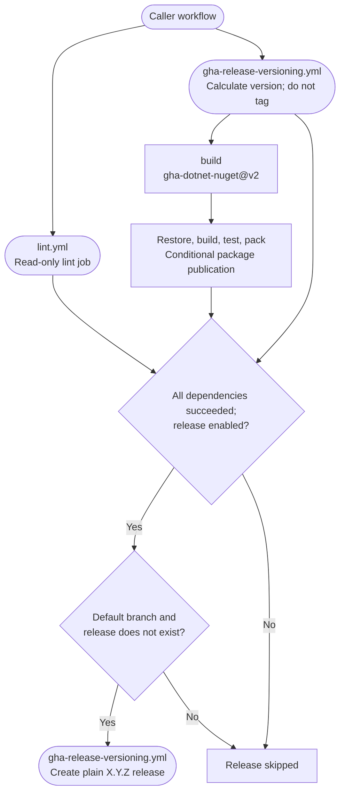

# NuGet Library Architecture

The [.NET NuGet library workflow](../.github/workflows/dotnet-nuget-library.yml) composes lint,
version calculation, a package build Action and a release workflow. Its release gate is not
the same as a gate on package publication.

## Build And Release Activity

Lint and versioning start independently. Build needs versioning only; release needs all three
jobs and its own branch/version condition.



Package-push policy belongs to the [gha-dotnet-nuget Action](https://github.com/f2calv/gha-dotnet-nuget),
not to the final release job. `release: false` disables tagging/releasing but does not itself
disable package publication. `push-preview` is forwarded to the Action for pre-release policy;
it is not a general publication-off switch. Because build does not depend on lint, package
publication can finish before lint fails. A caller that requires lint before publishing must
make that dependency explicit in its local build or publication job.

## Permission Boundaries

| Job | Permissions | Purpose |
| --- | --- | --- |
| Lint and versioning | `contents: read` | Read source and calculate the version |
| Build | `contents: read`, `packages: write`, `id-token: write` | Build and conditionally publish packages; request an OIDC token |
| Release | `contents: write` | Create a tag and GitHub Release after its dependencies succeed |

A caller of the complete reusable workflow must grant the union: `contents: write`,
`packages: write` and `id-token: write`. Nested jobs cannot elevate the caller's token, even if
a job would be skipped. Tests needing Compose services are not provisioned by this workflow.

## Trusted Publishing

nuget.org validates the OIDC `job_workflow_ref`. For a package repository calling this workflow
from another repository, the build job's workflow identity belongs to the reusable workflow,
not to the package repository. Granting `id-token: write` does not repair that mismatch.

For nuget.org Trusted Publishing, call the composite Action inside a local job instead. This
excerpt assumes existing `lint` and `versioning` jobs; the
[README usage pattern](../README.md#usage) shows calculation-only versioning. The build below
deliberately waits for lint before publication.

```yaml
build:
  needs: [lint, versioning]
  runs-on: ubuntu-26.04
  permissions:
    contents: read
    packages: write
    id-token: write
  steps:
    - uses: f2calv/gha-dotnet-nuget@v2
      with:
        GITHUB_TOKEN: ${{ secrets.GITHUB_TOKEN }}
        nuget-user: ${{ vars.NUGET_USER }}
        solution-name: Example.Release.slnx
        configuration: Release
        version: ${{ needs.versioning.outputs.version }}
        push-preview: ${{ github.event_name == 'workflow_dispatch' && inputs.push-preview }}
```

The local job must still match the nuget.org Trusted Publishing policy, including its workflow
file and owner. `NUGET_USER` is the public profile name, not an API key. Continue to call the
shared lint and versioning workflows; the package Action itself does not need a new inline
implementation.

## Validation Boundary

The [CI fixture caller](../.github/workflows/ci.yml) exercises the reusable workflow with
`release: false`. It verifies composition and credential-free build/test behavior, not a
successful nuget.org OIDC exchange or production package publication. The
[README dependency graph](../README.md#_dotnet-nuget-library) identifies the actions and nested
workflows used by this execution path.
