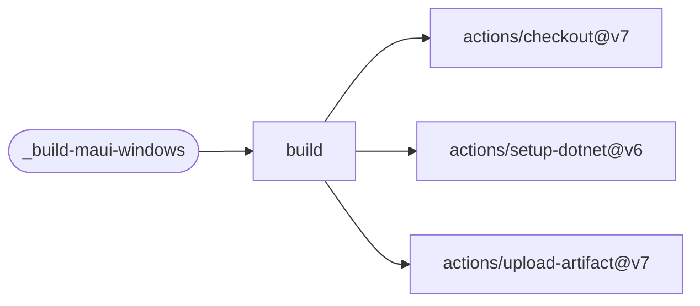

# Build MAUI Windows

Publish an unpackaged .NET MAUI Windows app and upload a downloadable artifact. The build is
self-contained by default, so testers do not need a .NET or Windows App SDK installation.

[Workflow catalogue](../README.md) | [Workflow source](../.github/workflows/build-maui-windows.yml)

## Key Inputs

| Inputs | Contract |
| --- | --- |
| `project` | Required MAUI project path. |
| `runs-on`, `configuration` | Defaults `windows-2025` and `Release`. |
| `target-framework`, `runtime-identifier` | Defaults `net10.0-windows10.0.19041.0` and `win-x64`. |
| `self-contained`, `dotnet-version` | Defaults `true` and `10.0.x`. |
| `app-display-version`, `app-version-code` | Defaults `1.0` and `1`. |
| `artifact-name`, `retention-days` | An empty name becomes `<project>-windows-<architecture>-<app-display-version>`; retention defaults to 14 days. |

## Permissions And Results

Grant `contents: read`; no additional credentials are needed. Every actor is built, including
Dependabot. The `artifact-name` reusable-workflow output names the uploaded artifact; consume
it through `needs.<job>.outputs.artifact-name`.

Publishing uses `RuntimeIdentifierOverride`, not `-r`, so a project that also targets Android
restores only the Windows runtime. This workflow uploads a build artifact; it does not publish
an app-store release. See the [shared caller contract](calling-workflows.md).

## Deployment Flow

The job uses checkout, .NET setup and artifact upload.

Repositories: [checkout](https://github.com/actions/checkout),
[setup-dotnet](https://github.com/actions/setup-dotnet),
[upload-artifact](https://github.com/actions/upload-artifact).
