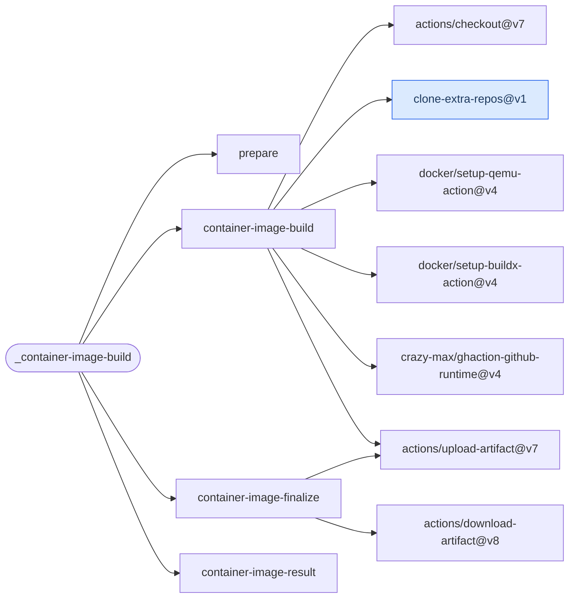

# Container Image Build

Build from one Dockerfile using either a single builder or parallel native-platform runners.
Native builds finish with a verified multi-platform image index.

[Workflow catalogue](../README.md) | [Workflow source](../.github/workflows/container-image-build.yml)

## Key Inputs

| Inputs | Contract |
| --- | --- |
| `registry`, `tag` | Required registry coordinate and version tag. |
| `repository`, `repository-prefix` | The default repository is the lowercased caller name without its owner; the prefix is optional. |
| `runs-on`, `dockerfile` | Defaults `ubuntu-26.04` and `Dockerfile`; build context is the checkout root. |
| `platform`, `platform-runners`, `artifact-name` | Default platforms `linux/amd64,linux/arm64,linux/arm/v7`. Empty runner mapping keeps the single-builder path; a native mapping covers each requested platform exactly once. Use a unique artifact prefix per native call. |
| `args` | Whitespace-separated Buildx arguments; no quote interpretation or expansion, so an argument cannot contain a space. |
| `buildkit-cache`, `attestations` | Both default to `false`. |
| `push-image` | Defaults to `true`; the caller must explicitly restrict publication. Dependabot never publishes. |
| `default-branch`, `default-branch-tag`, `feature-branch-tag` | Defaults `refs/heads/main`, `latest` and `latest-dev`. |
| `smoke-test`, `smoke-test-platform` | Optional command receiving `$IMAGE`; the default smoke platform is `linux/amd64`. Native mode tests each native target. |
| `github-private-packages-auth`, `extra-repos` | Optional private package access and additional source clones; see the source and [shared caller contract](calling-workflows.md). |

## Coordinates And Publication

For GHCR, use `registry: ghcr.io/${{ github.repository_owner }}` with the owner-free default
repository, or `registry: ghcr.io` with `repository: ${{ github.repository }}`. Do not include
the owner twice. Registry, repository and tags are lowercased and validated.

The workflow logs in with `GITHUB_TOKEN`, not an independent ACR or Docker Hub credential.
Grant `contents: read` and `packages: write`, including publication-off calls: the reusable
jobs declare both. `push-image: false` skips registry login. Existing-tag immutability is not
enforced by this workflow.

## Native Builds And Results

The [container architecture guide](architecture-container-images.md) has the native caller
example, build decisions, OCI data flow, cache scopes and artifact hand-offs. Use a release or
commit containing `platform-runners`; older `@v1` implementations may not accept it.

Native publication uses per-platform registry digests, then assembles the index. Without
publication, it transfers Docker archives and verifies the index in a disposable loopback
registry. This needs an isolated Docker daemon with port 5000 available. Platform and index
artifacts have one-day retention; no named reusable-workflow outputs are declared.

The `container-image-result` job rejects failure, cancellation and unexpected skips. Select
`<caller job> / container-image-result` as a required check rather than a platform-specific
matrix check. Caller jobs that publish dependent charts should wait for the entire image workflow.

## Deployment Flow

These are action dependencies, not build execution order. QEMU serves the legacy path; artifact
download serves native finalization. Blue identifies the repository-owned clone action.

Repositories: [checkout](https://github.com/actions/checkout),
[clone-extra-repos](../.github/actions/clone-extra-repos/action.yml),
[setup-qemu-action](https://github.com/docker/setup-qemu-action),
[setup-buildx-action](https://github.com/docker/setup-buildx-action),
[ghaction-github-runtime](https://github.com/crazy-max/ghaction-github-runtime),
[upload-artifact](https://github.com/actions/upload-artifact),
[download-artifact](https://github.com/actions/download-artifact).
