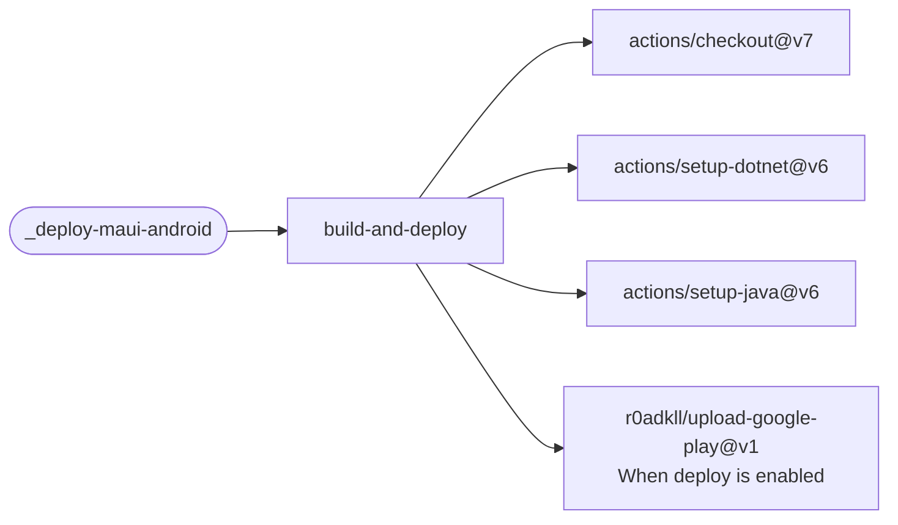

# Deploy MAUI Android

Publish an unsigned .NET MAUI Android app bundle, or sign it and upload it to Google Play.

[Workflow catalogue](../README.md) | [Workflow source](../.github/workflows/deploy-maui-android.yml)

## Key Inputs

| Inputs | Contract |
| --- | --- |
| `project` | Required MAUI project path. |
| `runs-on`, `configuration` | Defaults `ubuntu-26.04` and `Release`. |
| `target-framework`, `dotnet-version`, `java-version` | Defaults `net10.0-android`, `10.0.x` and Microsoft OpenJDK `17`. |
| `deploy`, `package-name`, `play-track` | Deployment defaults to `false`; deployment requires a Play application ID. The track defaults to `internal`. |
| `app-display-version`, `app-version-code` | Defaults `1.0` and `1`. |

## Signing And Publication

Grant `contents: read`. Unsigned validation requires no signing credentials. With `deploy: true`,
map `ANDROID_KEYSTORE_BASE64`, `ANDROID_KEYSTORE_PASSWORD`, `ANDROID_KEY_ALIAS`,
`ANDROID_KEY_PASSWORD` and `GOOGLE_PLAY_SERVICE_ACCOUNT_JSON` as declared secrets.
Signing secrets reach MSBuild through environment variables, not command-line properties.

Microsoft OpenJDK is selected explicitly because a runner's default JDK may not be supported
by .NET for Android. Dependabot skips the job. Callers must restrict Play publication to trusted
events and appropriate release controls. There are no named reusable-workflow outputs.
See the [shared secret contract](calling-workflows.md#permissions-and-secrets).

## Deployment Flow

Google Play upload is conditional on `deploy`; toolchain actions also serve unsigned builds.

Repositories: [checkout](https://github.com/actions/checkout),
[setup-dotnet](https://github.com/actions/setup-dotnet),
[setup-java](https://github.com/actions/setup-java),
[upload-google-play](https://github.com/r0adkll/upload-google-play).
