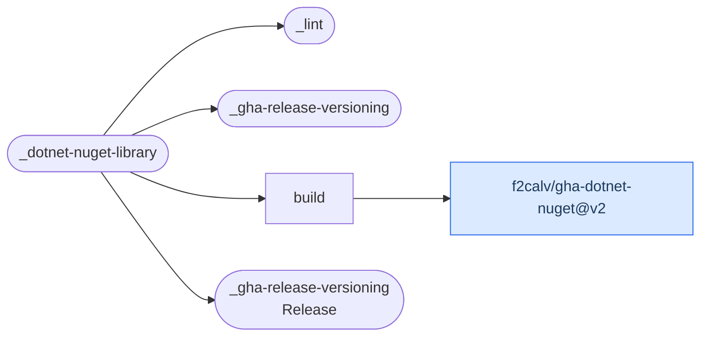

# .NET NuGet Library

Compose lint, semantic versioning, .NET build/test/pack/push and an optional plain `X.Y.Z`
GitHub Release for a library repository.

[Workflow catalogue](../README.md) | [Workflow source](../.github/workflows/dotnet-nuget-library.yml)

## Key Inputs

| Inputs | Contract |
| --- | --- |
| `runs-on`, `solution-name`, `configuration` | Defaults `ubuntu-26.04`, empty target and `Release`. |
| `execute-tests`, `code-coverage` | Both default to `true`; forwarded to the package Action. |
| `dotnet-test-args`, `dotnet-restore-args` | Optional arguments using the companion Action's contract. |
| `push-preview`, `package-filter`, `nuget-user` | Preview push defaults to `false`; optional package-prefix filter and nuget.org profile name. |
| `release` | Default `true`; disables tagging/releasing when false, not package publication. |

## Permissions And Publication

Grant the union `contents: write`, `id-token: write` and `packages: write`. Build depends only
on versioning, not lint, so package publication may finish before lint fails. Test-service
provisioning is not supported by this workflow. There are no named reusable-workflow outputs.

For nuget.org Trusted Publishing, call [gha-dotnet-nuget](https://github.com/f2calv/gha-dotnet-nuget)
inside a local job: a cross-repository reusable build does not satisfy the package repository's
workflow identity check. The [NuGet architecture guide](architecture-nuget-library.md) shows
the execution graph, release gate and local-job alternative that waits for lint.

## Deployment Flow

This graph shows nested workflow and Action dependencies, not execution ordering. Blue identifies
the companion package Action. The architecture guide defines the actual `needs` relationships.

Dependencies: [lint](lint.md), [versioning and release](gha-release-versioning.md),
[gha-dotnet-nuget](https://github.com/f2calv/gha-dotnet-nuget).
