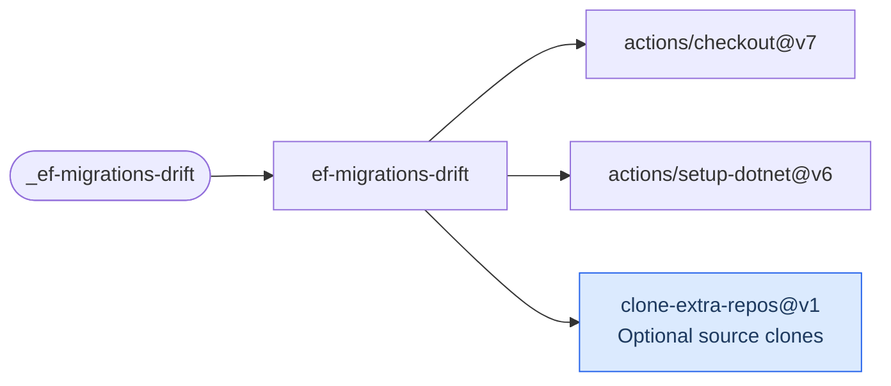

# EF Migrations Drift

Fail when an EF Core model has schema changes that are not captured by a migration. The check
runs `dotnet ef migrations has-pending-model-changes` without requiring a live database.

[Workflow catalogue](../README.md) | [Workflow source](../.github/workflows/ef-migrations-drift.yml)

## Key Inputs

| Input | Contract |
| --- | --- |
| `project` | Required migrations/target project or solution. |
| `runs-on` | Default `ubuntu-26.04`. |
| `startup-project` | Empty defaults to `project`. |
| `context` | Optional DbContext name; omit when there is one context. |
| `configuration` | Default `Release`. |
| `extra-repos` | Optional clones for project dependencies; see [extra repositories](calling-workflows.md#extra-repositories). |

## Permissions And Prerequisites

Grant `contents: read`. The caller must pin `dotnet-ef` in `.config/dotnet-tools.json` and provide
an `IDesignTimeDbContextFactory` configured with the migrations provider. The workflow installs
.NET SDKs 10 and 11 and restores tools. It returns success/failure, not named outputs.

## Deployment Flow

The job uses checkout, .NET setup and optional extra-source clones. The blue action is owned
by this repository.

Repositories: [checkout](https://github.com/actions/checkout),
[setup-dotnet](https://github.com/actions/setup-dotnet),
[clone-extra-repos](../.github/actions/clone-extra-repos/action.yml).
