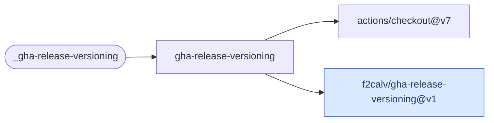

# Release Versioning

Calculate a semantic version with GitVersion, create its tag and optionally publish a GitHub
Release through the companion versioning Action.

[Workflow catalogue](../README.md) | [Workflow source](../.github/workflows/gha-release-versioning.yml)

## Key Inputs

| Inputs | Contract |
| --- | --- |
| `runs-on`, `semVer` | Default runner `ubuntu-26.04`; empty version runs GitVersion. |
| `tag-prefix`, `move-major-tag` | Defaults `v` and `true`. Override both to `''` and `false` for non-Action repository releases. |
| `tag-and-release`, `tag-only` | Defaults `true` and `false`; use `tag-and-release: false` with `tag-only: false` for calculation only. |
| `release-branch` | Empty uses the repository default branch. |
| `gv-config`, `gv-source` | Defaults `GitVersion.yml` and `actions`. |

## Permissions And Outputs

Grant `contents: read` for calculation, or `contents: write` for publication. The automatic
token is forwarded to the companion Action; full authenticated history is checked out internally.
The [root quick start](../README.md#quick-start) calculates a version without publishing.

| Output | Meaning |
| --- | --- |
| `version` | GitVersion FullSemVer or the supplied `semVer`. |
| `major`, `minor`, `patch` | Individual version components. |
| `release-exists` | String `true`/`false` indicating a GitHub Release, not merely a tag. |

Consume outputs through `needs.<job>.outputs.<name>`. The companion Action's alias switch moves
both major and minor aliases, not just the major. Do not enable it for a major-only alias policy;
see the [Action's publishing limitation](https://github.com/f2calv/gha-release-versioning#publishing).

## Deployment Flow

The workflow delegates calculation and publication to the blue companion Action.

Repositories: [checkout](https://github.com/actions/checkout),
[gha-release-versioning](https://github.com/f2calv/gha-release-versioning).
