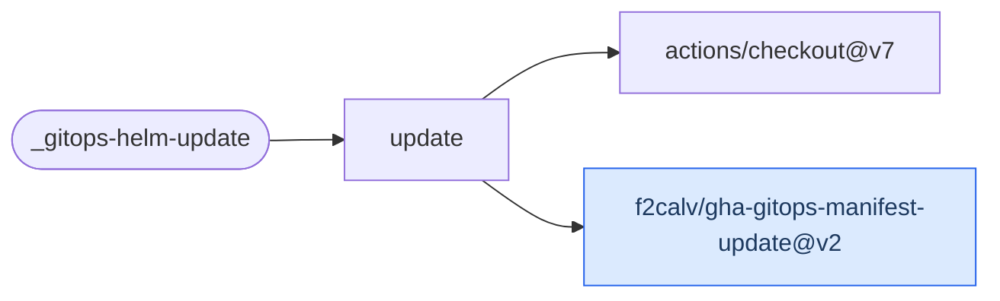

# GitOps Helm Update

Edit image and chart coordinates in Argo CD Helm manifests, validate chart rendering and
optionally commit and push the updated manifests in a target GitOps repository.

[Workflow catalogue](../README.md) | [Workflow source](../.github/workflows/gitops-helm-update.yml)

## Key Inputs

| Inputs | Contract |
| --- | --- |
| `manifest-paths`, `tag`, `namespace`, `image-registry`, `image-repository`, `gitops-repo` | Required manifest paths, version, destination and target repository. Manifest paths are space-separated text, not JSON. |
| `runs-on`, `environment` | Default runner `ubuntu-26.04`; optional GitHub environment with its protection rules. |
| `tag-override`, `chart-registry`, `chart-registry-username`, `chart-repository` | Image override and chart coordinates forwarded to the manifest-update Action. |
| `gitops-repo-path`, `gitops-repo-branch` | Defaults `.` and `main`. The branch is forwarded to the Action, not checkout's `ref`. |
| `gitops-repo-update` | Default `true`; `false` disables Git commit/push, not edits or rendering validation. |
| `gitops-repo-user-name`, `gitops-repo-user-email` | Optional commit identity; defaults to the workflow bot identity. |
| `devcontainer-path` | Default `.devcontainer/devcontainer.json`; resolves tool versions. |

## Permissions And Secrets

Grant `contents: read` and `packages: read`. Map the declared `GH_PAT_GITOPS` secret with
target-repository access; it is used for checkout and optional commits. `GITHUB_TOKEN` is
the chart registry password, not a substitute for the target-repository token.

Dependabot skips the job. Keep target coordinates and environment values in caller-controlled
variables or secrets. Restrict manifest publication to trusted events. See the
[architecture caller example](architecture-helm-gitops.md#caller-contract).

## Results

The workflow has no named outputs. It edits and validates the checkout even when Git updates
are disabled. A successful manifest push does not establish live controller reconciliation,
rollout or application readiness.

## Deployment Flow

The workflow checks out the target; the blue companion Action owns edits, rendering and Git updates.

Repositories: [checkout](https://github.com/actions/checkout),
[gha-gitops-manifest-update](https://github.com/f2calv/gha-gitops-manifest-update).
