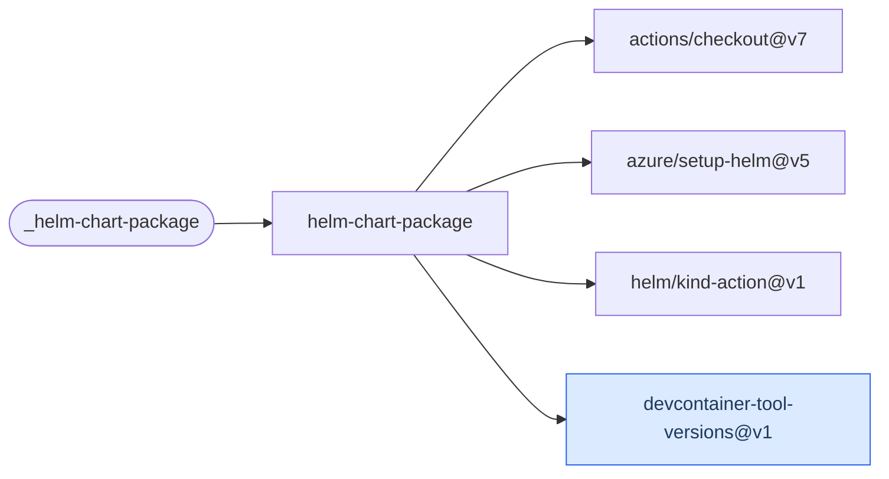

# Helm Chart Package

Validate, package and optionally push a Helm chart to an OCI registry, with lint or
KIND-backed chart-testing modes.

[Workflow catalogue](../README.md) | [Workflow source](../.github/workflows/helm-chart-package.yml)

## Key Inputs

| Inputs | Contract |
| --- | --- |
| `tag`, `image-registry`, `image-repository`, `chart-registry`, `chart-repository` | Required version and registry coordinates, even when the chart has no image. |
| `runs-on`, `chart-path` | Default runner `ubuntu-26.04`; select a concrete chart directory, not the default `./charts/` as a discovery mechanism. |
| `tag-override`, `set-chart-app-version` | Optional image-tag override; appVersion rewriting defaults to `true`. |
| `is-library-chart`, `has-image` | Defaults `false` and `true`; library charts skip rendering/install tests, and image-free charts skip image-value rewriting. |
| `push-chart`, `chart-registry-username` | Push defaults to `true`; supply the registry username. Login still runs when push is disabled. |
| `chart-dependency-name` | Optional named local dependency to version with `tag`. |
| `chart-testing-cli-command`, `chart-testing-cli-version` | Modes `lint` (default), `install` or `skip`; default chart-testing image `v3.15.0`. |

## Permissions And Prerequisites

Grant `contents: read` and `packages: write`, including publication-off calls. The registry
password is `GITHUB_TOKEN`. The runner needs Docker, jq, Node/npm and yq; the Helm version
comes from the caller's `.devcontainer/devcontainer.json`.

The chart directory basename, `Chart.yaml` name and final segment of `chart-repository` must
agree, for example `example` and `owner/charts/example`. Coordinates and image tags are
normalized and validated. Packaging can change version, appVersion, image/provenance values
and a named dependency.

## Testing And Publication

Packaging always runs `helm lint`. `skip` skips chart-testing only. `install` creates a KIND
cluster for application charts; library charts still package and lint. With install mode,
`push-chart: false` and `has-image: true`, testing substitutes `nginx:latest`, not the caller's
unpublished application image.

The package remains on the runner when push is disabled; it is not uploaded as an artifact.
There are no named outputs. See [Helm and GitOps architecture](architecture-helm-gitops.md)
for the mode decisions and caller-owned image/chart/manifest dependencies.

## Deployment Flow

KIND setup is used for install tests. Blue identifies the repository-owned version reader.

Repositories: [checkout](https://github.com/actions/checkout),
[setup-helm](https://github.com/azure/setup-helm), [kind-action](https://github.com/helm/kind-action),
[devcontainer-tool-versions](../.github/actions/devcontainer-tool-versions/action.yml).
