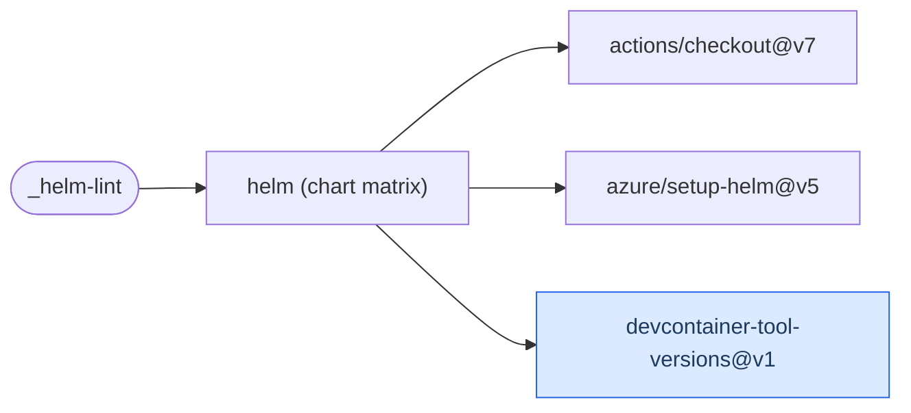

# Helm Lint

Build chart dependencies and run `helm lint` against each chart and every `ci/*-values.yaml`
fixture. No cluster is needed.

[Workflow catalogue](../README.md) | [Workflow source](../.github/workflows/helm-lint.yml)

## Key Inputs

| Input | Contract |
| --- | --- |
| `charts` | Required JSON array of chart directories, such as `["charts/example"]`. |
| `runs-on` | Default `ubuntu-26.04`; one matrix job per chart. |
| `require-ci-values` | Default `true`; fail when no fixture values exist. |
| `helm-version` | Optional version override. |
| `devcontainer-path` | Default `.devcontainer/devcontainer.json`; supplies Helm's version when no override is set. |

## Permissions And Results

Grant `contents: read`. The workflow checks charts but neither packages nor publishes them,
and declares no named outputs. Use [Helm Chart Package](helm-chart-package.md) for packaging
and optional install tests.

## Deployment Flow

The version-reader action is optional when `helm-version` is supplied. Blue identifies the
repository-owned action.

Repositories: [checkout](https://github.com/actions/checkout),
[setup-helm](https://github.com/azure/setup-helm),
[devcontainer-tool-versions](../.github/actions/devcontainer-tool-versions/action.yml).
