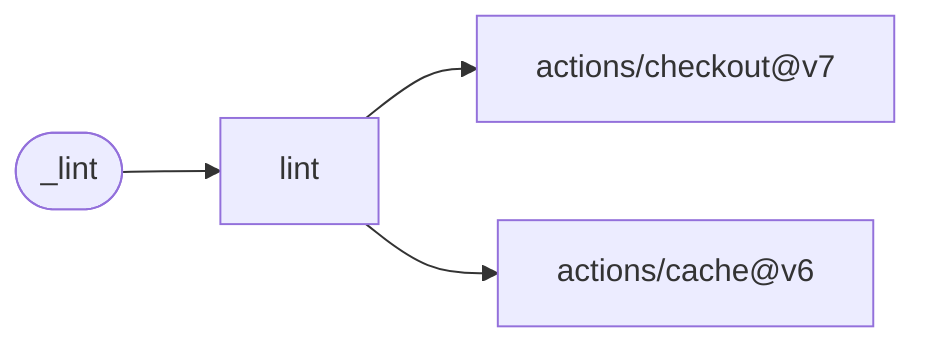

# Lint

Run the caller's pre-commit hooks against all repository files, caching hook environments
by configuration.

[Workflow catalogue](../README.md) | [Workflow source](../.github/workflows/lint.yml)

## Key Inputs

| Input | Contract |
| --- | --- |
| `runs-on` | Default `ubuntu-26.04`. |
| `pre-commit-version` | Default `4.6.2`. |

## Permissions And Prerequisites

Grant `contents: read`. Provide `.pre-commit-config.yaml` in the caller. Hooks may need network
access to install their runtimes and dependencies. A successful job checks the configured hooks;
it does not publish artifacts or declare named outputs.

Use [pre-commit](https://pre-commit.com/) for local execution. Callers must make publication jobs
depend on lint when a passing lint gate is required before publication.

## Deployment Flow

Checkout supplies source; the cache stores pre-commit environments.

Repositories: [checkout](https://github.com/actions/checkout),
[cache](https://github.com/actions/cache).
