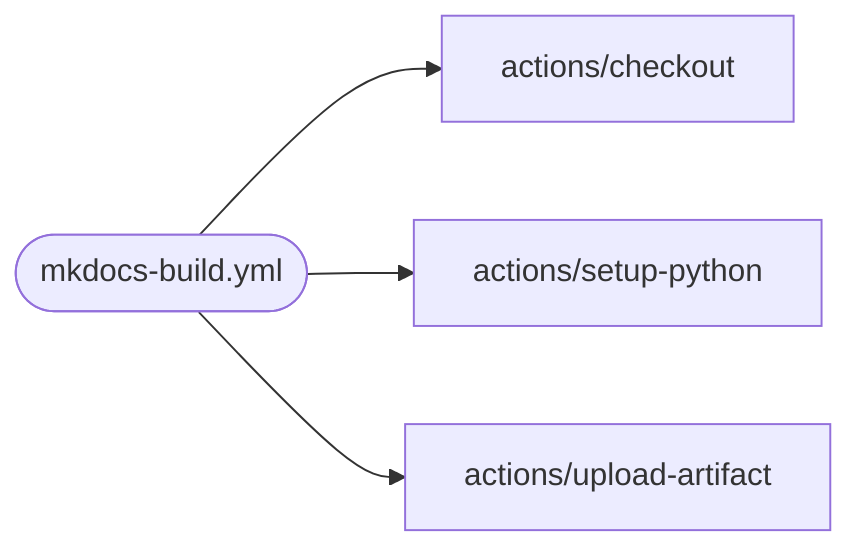

# MkDocs Build

Build searchable documentation with locked Python dependencies and strict validation. Ordinary
repositories need no preparation script. The workflow uploads a normal Actions artifact; the
caller owns Pages settings and deployment.

[Workflow catalogue](../README.md) · [Workflow source](../.github/workflows/mkdocs-build.yml)

## Availability

This workflow is new in the current checkout. The example becomes usable after a release moves
`@v1` to a commit containing it. Local checks do not establish hosted deployment readiness.

## Inputs

| Input | Default | Purpose |
| --- | --- | --- |
| `working-directory` | `.` | MkDocs project directory. |
| `config-file` | `mkdocs.yml` | Configuration relative to that directory. |
| `requirements-file` | `.config/docs-requirements.txt` | Locked documentation dependencies. |
| `python-version` | `3.13` | Build Python version. |
| `site-directory` | `site` | Generated output relative to the project. |
| `site-url` | Empty | Optional canonical deployment URL; otherwise retain the configuration value. |
| `artifact-name` | `mkdocs-site` | Artifact for deployment or complete-site assembly. |
| `retention-days` | `7` | Artifact retention. |
| `prepare-script` | Empty | Optional caller-owned PowerShell staging; unnecessary for normal `docs/` projects. |
| `runs-on` | `ubuntu-26.04` | Build runner. |

The build needs only `contents: read` and no secrets. Its output is `artifact-name`. The artifact
preserves generated dot-prefixed directories; `site-directory` must contain only reviewed build
output, never a checkout or private local files.

## Minimal Consumer

Add canonical Markdown under `docs/`, `mkdocs.yml` and locked requirements. With approval, enable
GitHub Pages with **GitHub Actions** as its source. Use this as `.github/workflows/docs.yml`,
adjusting `main` when the default branch differs:

```yaml
name: docs

on:
  push:
    branches: [main]
  pull_request:
    branches: [main]

concurrency:
  group: ${{ github.workflow }}-${{ github.ref }}
  cancel-in-progress: false

permissions: {}

jobs:
  build:
    uses: f2calv/gha-workflows/.github/workflows/mkdocs-build.yml@v1
    with:
      site-url: https://${{ github.repository_owner }}.github.io/${{ github.event.repository.name }}/
    permissions:
      contents: read

  deploy:
    if: github.event_name == 'push' && github.ref == format('refs/heads/{0}', github.event.repository.default_branch)
    needs: build
    runs-on: ubuntu-26.04
    concurrency:
      group: pages
      cancel-in-progress: false
    permissions:
      contents: read
      pages: write
      id-token: write
    environment:
      name: github-pages
      url: ${{ steps.deploy.outputs.page_url }}
    steps:
      - uses: actions/download-artifact@v7
        with:
          name: mkdocs-site
          path: site

      - uses: actions/configure-pages@v5

      - uses: actions/upload-pages-artifact@v5
        with:
          path: site
          include-hidden-files: true

      - uses: actions/deploy-pages@v5
        id: deploy
```

Pull requests build only; forks and dependency bots need no deployment secrets. Deployment uses
the official Pages actions and protected `github-pages` environment, not `mkdocs gh-deploy` or
a publishing-branch script. Supply the actual canonical URL for custom domains or account sites.

## Shared Sites

The minimal consumer assumes documentation owns the whole site. A Pages deployment replaces all
previous content, including catalogues and chart feeds. When another producer owns the root,
download documentation into a reserved subpath of its complete artifact and retain one publisher.
Reject an existing destination before copying and verify that protected indexes remain unchanged.
Keep their generation authority with the existing publishers, not a scrape of the live site.

Preparation is optional repository policy for scattered public sources, not a script every
consumer must copy.

The official Pages artifact action always excludes `.git` and `.github`, even with hidden files
enabled. Keep published guidance in a normal output directory; canonical sources may still live
under `.github`. Other reviewed dot-prefixed assets require hidden-file inclusion in both artifact
transfers. Never broaden uploads to private checkout contents to accommodate them.

Use fresh output when checking a local publication payload: MkDocs `--clean` intentionally retains
dot-prefixed directories. Hosted builds start from a clean checkout and generate a new site.

## Dependency Graph



The [self-tests](self-tests.md) exercise the current-commit workflow without staging. Default-branch
pushes additionally deploy the synthetic fixture and verify its live pages, search and exact
commit marker. An explicitly approved feature-branch canary uses
`gh workflow run ci.yml --ref <feature-branch> -f test-pages=true`; ordinary dispatches and pull
requests do not deploy. The protected Pages environment must allow the exact canary branch.
This publishes fixture documentation only, not application or package artifacts.
