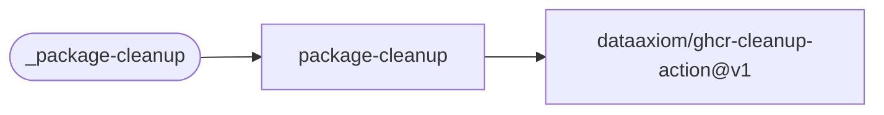

# Package Cleanup

Prune old container and Helm chart versions from GHCR. Dry-run is enabled by default.

[Workflow catalogue](../README.md) | [Workflow source](../.github/workflows/package-cleanup.yml)

## Key Inputs

| Input | Contract |
| --- | --- |
| `packages` | Required comma-separated package names without the owner, such as `example-app,charts/example-app`. |
| `runs-on` | Default `ubuntu-26.04`. |
| `keep-n-tagged` | Default `10`; retain the most recent tagged versions. |
| `exclude-tags` | Default `latest`; excluded tag patterns take priority over other rules. |
| `older-than` | Optional age filter, such as `30 days`; default empty. |
| `delete-untagged` | Default `true`; delete untagged orphans. |
| `dry-run` | Default `true`; log planned deletion without changing packages. |

## Permissions And Deletion

Grant `packages: write`. The automatic token must administer the target owner's packages.
Set `dry-run: false` only when real deletion is intended, and restrict the caller to trusted
events. There are no named outputs. Refer to the cleanup Action for its matching semantics.

## Deployment Flow

The workflow delegates cleanup policy and deletion to one external action.

Repository: [ghcr-cleanup-action](https://github.com/dataaxiom/ghcr-cleanup-action).
