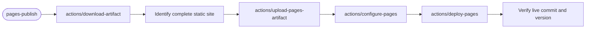

# Pages Publishing

Prepare a complete static-site artifact and optionally deploy it through the official GitHub
Pages actions. The caller owns build validation, Pages settings and release fan-in.

[Workflow catalogue](../README.md) · [Workflow source](../.github/workflows/pages-publish.yml)

## Contract

| Input | Default | Purpose |
| --- | --- | --- |
| `artifact-name` | Required | Normal Actions artifact from the current workflow run. |
| `version` | Required | Build identity recorded with the caller commit in `deployment.json`. |
| `publish` | `false` | Deploy a default-branch push or explicit manual run; never a PR. |
| `pages-artifact-name` | `github-pages` | Intermediate Pages artifact; use distinct names for fixtures. |
| `runs-on` | `ubuntu-26.04` | Runner. |

The caller grants `contents: read`, `pages: write` and `id-token: write`, including non-deploying
fixture calls because GitHub validates nested permissions before job conditions. Preparation
downloads the site, requires nonempty `index.html`, records its identity and packages it.
Deployment uses the `github-pages` environment, queues concurrent deployments and verifies the
live identity JSON against the current commit and version. The `page-url` output is empty when
deployment is skipped.

Enable Pages with GitHub Actions as its source and configure the environment to permit only the
default branch. One publisher owns the complete site: deployment replaces existing content.
Do not supply a source checkout, private configuration or unreviewed output as the artifact.

## Consumer

```yaml
pages:
  needs: [lint, versioning, build]
  if: github.event_name == 'push' && github.ref == format('refs/heads/{0}', github.event.repository.default_branch)
  uses: f2calv/gha-workflows/.github/workflows/pages-publish.yml@v1
  permissions:
    contents: read
    pages: write
    id-token: write
  with:
    artifact-name: frontend
    version: ${{ needs.versioning.outputs.version }}
    publish: true
```

Release tagging must wait for successful deployment as well as lint/build/tests. Use queued
default-branch CI, not whole-run cancellation that can interrupt deployment. PR CI can cancel
superseded runs. The live JSON check proves deployment identity, not application functionality;
verify the browser and offline behavior at the published URL separately.

## Deployment Flow



The package-only fixture never deploys. Trusted default-branch deployment is canaried by a real
application caller after the shared workflow release.
