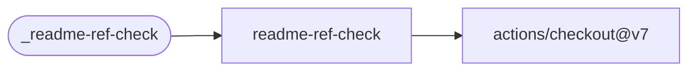

# README Reference Check

Require a README to reference the exact floating major tag. A reference to `@v2.1` does not
satisfy a required `@v2` reference.

[Workflow catalogue](../README.md) | [Workflow source](../.github/workflows/readme-ref-check.yml)

## Key Inputs

| Input | Contract |
| --- | --- |
| `major` | Required major version, such as `1`. |
| `runs-on` | Default `ubuntu-26.04`. |
| `reference-prefix` | Optional regular expression preceding the tag. The default matches the caller as an Action: `owner/action@vN`. |
| `readme-path` | Default `README.md`. |

## Permissions And Results

Grant `contents: read`. For a reusable-workflow repository, provide a prefix matching the
workflow path; the [self-test caller](../.github/workflows/ci.yml) demonstrates this.
The check does not edit the README and has no named outputs.

## Deployment Flow

Checkout supplies the README; the reference check runs as a shell step in the job.

Repository: [checkout](https://github.com/actions/checkout).
