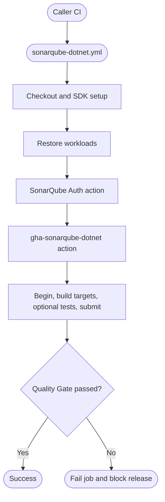

# SonarQube .NET

[Workflow catalogue](../README.md) · [Workflow source](../.github/workflows/sonarqube-dotnet.yml)

Reusable SonarQube Cloud analysis for public .NET repositories, including supported
non-.NET source and configuration files. It wraps the existing
[gha-sonarqube-dotnet action](https://github.com/f2calv/gha-sonarqube-dotnet) rather than
duplicating scanner logic.

## Availability and Setup

This workflow uses the published action's `@v3` alias. Its feature-branch canary verified
live OIDC, .NET and MAUI builds, coverage import, multi-language analysis and the Quality Gate
before the action was released. Consumers can adopt the workflow once it appears in the
shared repository's published `@v1` reference.

In SonarQube Cloud:

1. Bind the project to its GitHub repository.
2. Enable **Administration > Organization settings > Analysis > Enable secretless analysis
   for GitHub Actions**.
3. Disable automatic analysis for projects adopting this CI scanner. Eligible repositories
   that do not need CI-based analysis can retain automatic analysis.

No stored `SONAR_TOKEN` or inherited secrets are required. The official auth action obtains
a project-scoped token valid for 30 minutes and supplies the organization/project keys.
Workloads are restored before authentication. The EU region is currently supported by this
wrapper; regional and SonarQube Server callers can use the underlying action directly.

Missing OIDC permission, disabled secretless analysis or an invalid binding fails the job;
there is no successful skip or fallback. Fork/Dependabot permission restrictions must be
verified in hosted CI before making the analysis a required merge gate. Never use
`pull_request_target` to execute untrusted pull-request code with elevated permissions.

## Caller

Add an independent job and include it in the caller's release fan-in:

```yaml
sonarqube:
  uses: f2calv/gha-workflows/.github/workflows/sonarqube-dotnet.yml@v1
  with:
    solution-name: Example.slnx
    execute-tests: true
    dotnet-test-args: '["--minimum-expected-tests", "4"]'
  permissions:
    contents: read
    id-token: write
```

Callers grant both permissions even when the job is conditionally skipped. Keep normal
build/test jobs: the scanner changes analyzer settings, so its build does not replace the
repository's ordinary build validation.

## Key Inputs

| Input | Default | Purpose |
| --- | --- | --- |
| `runs-on` | `ubuntu-26.04` | Use `windows-2025` for projects containing Windows-only C#. |
| `dotnet-version` | `11.0.x` | SDK versions, including multiline versions for multi-target fixtures. |
| `solution-name` | Required | Primary `.sln`, `.slnx` or `.csproj` build/test target. |
| `additional-projects` | `[]` | JSON array of extra projects compiled before submission. |
| `project-base-directory` | `.` | Analysis root; target paths are relative to it. |
| `sonar-project-key` | Discovered | Set explicitly when a repository binds several Cloud projects. |
| `sonar-exclusions` | Generated build/tool directories | Exclude output, not all fixtures or test sources. |
| `build-configuration` | `Release` | Build/test configuration. |
| `execute-tests` | `false` | Run MTP tests on the primary target and import coverage. |
| `dotnet-test-args` | `[]` | JSON array of literal test arguments. |
| `coverage-report-paths` | Scanner's generated report when testing | Microsoft coverage XML to import. |

## Analysis Activity

The caller controls scheduling and release dependencies. Authentication and upload run in
the same job; the short-lived token is not passed through workflow outputs or artifacts.



## Results and Validation Boundaries

The job reports `sonarqube`; in this repository the reusable check is
`sonarqube / sonarqube`. SonarQube Cloud additionally reports `SonarCloud Code Analysis`
through its GitHub integration. The workflow waits for and enforces the Quality Gate.
There are no workflow outputs or publication steps.

The scanner analyzes compiled C#, including test projects, and supported non-.NET languages
under the analysis root. Workflow YAML and shell content remain subject to actionlint,
zizmor and ShellCheck; secret detection is not full Bash semantic analysis. Rust's separate
Clippy/test pipeline is retained. Coverage here measures the .NET fixture, not execution of
the whole workflow graph.

Local action tests use fake scanner/build commands. They verify failure propagation,
argument handling, multi-project sequencing and submission without cloud access.
Live OIDC, language indexing, MAUI integration and actual alerts require the first hosted run.
Keep the baseline SonarCloud exclusion until that run produces the expected check; remove
it and apply the baseline only after verification.
