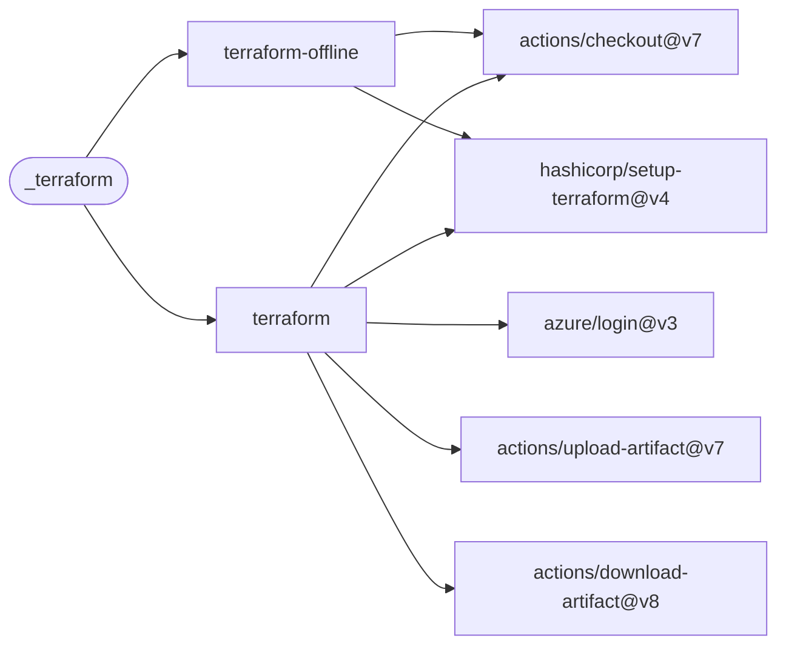

# Terraform

Run backend-free validation/tests or Azure-backed plan, apply and recovery operations for
a Terraform root module.

[Workflow catalogue](../README.md) | [Workflow source](../.github/workflows/terraform.yml)

## Key Inputs

| Inputs | Contract |
| --- | --- |
| `working-directory`, `runs-on` | Required root-module directory; default runner `ubuntu-26.04`. |
| `command`, `terraform-version` | Default `plan` and `1.13.3`; commands `validate`, `test`, `plan`, `apply`, `plan+apply`, `destroy`. |
| `environment`, `environment-files` | Optional protected GitHub environment and newline-separated YAML files relative to the checkout root. |
| `backend-config`, `backend-config-file`, `azure-backend-key`, `var-file` | Optional backend and variable settings; file paths are relative to `working-directory`. Backend settings are one `key=value` per line. |
| `azure-login`, `use-oidc` | Both default to `true` for online operations. |
| `artifact-name`, `log-level` | Defaults `tfplan` and `ERROR`. |
| `deployment-version`, `deployment-commit`, `deployment-layer` | Optional IaC provenance passed as Terraform variables. |
| `lock-id`, `state-rm` | Destructive state-recovery controls, not normal validation options. |
| `expected-release-tag`, `readme-path` | Optional exact README release-reference check; default path `README.md`. |

## Commands And Artifacts

`validate` and `test` use `terraform init -backend=false` without Azure authentication. They
still download providers/modules as needed. Online commands initialize the backend. A `plan`
uploads binary/text plan artifacts; a dependent `apply` job consumes the binary artifact from
the same workflow run. No cross-run artifact ID is accepted. `plan+apply` performs both in one
job, and `destroy` auto-approves. There are no named reusable-workflow outputs.

Environment files contain scalar top-level key/value pairs; later files override earlier ones.
`azure-backend-key` requires `TF_VAR_backend_resource_group_name`,
`TF_VAR_backend_storage_account_name` and `TF_VAR_backend_container_name` from those files.

## Permissions And Secrets

Grant `contents: read` and `id-token: write` for every command: GitHub validates the online
job's permissions at startup even when that job is skipped. Online Azure operations need
`ARM_TENANT_ID`, `ARM_SUBSCRIPTION_ID` and `ARM_CLIENT_ID`; client-secret mode additionally
needs `ARM_CLIENT_SECRET`. Callers own event restrictions and protected-environment approvals
for state mutations. See the [shared secret contract](calling-workflows.md#permissions-and-secrets).

## Deployment Flow

Backend-free and online jobs are alternatives selected by `command`. Login and plan-artifact
transfer actions belong only to the online job.

Repositories: [checkout](https://github.com/actions/checkout),
[setup-terraform](https://github.com/hashicorp/setup-terraform), [login](https://github.com/azure/login),
[upload-artifact](https://github.com/actions/upload-artifact),
[download-artifact](https://github.com/actions/download-artifact).
